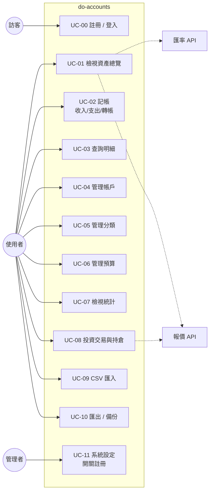
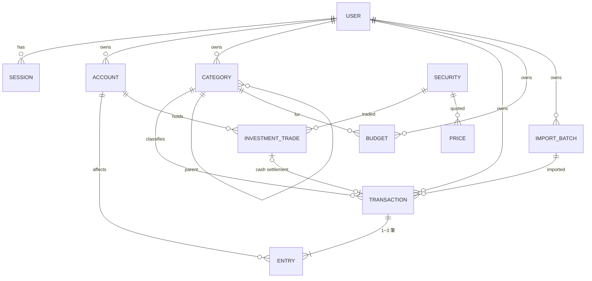
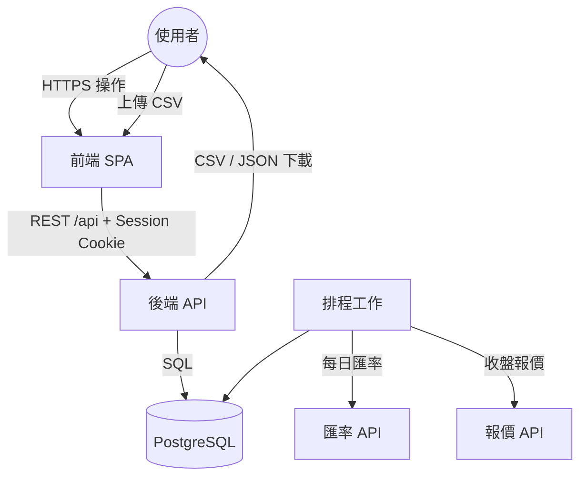

# 系統分析文件（SA — System Analysis）

# do-accounts 個人記帳理財系統（新版）

| 項目 | 內容 |
|---|---|
| 文件版本 | 0.1（草案，待確認） |
| 系統版本 | 2.0.0（規劃中） |
| 撰寫日期 | 2026-11-09 |
| 文件性質 | 系統分析（SA） |
| 前身系統 | [alexsuze/money](https://github.com/alexsuze/money) v1.2.0 |
| 相關文件 | [SD.md（系統設計文件）](./SD.md) |

---

## 1. 專案概述

### 1.1 專案背景

舊版 `money` 是給單一使用者用的記帳 Web App，功能包含多帳戶、多幣別、收支與轉帳、預算和統計圖表。它的核心功能已經可以用，但在架構上有幾個先天限制：

- API 沒有任何身分驗證，任何人只要知道網址就能讀寫資料（舊 SA OBS-1）。
- 資料庫用 MongoDB 文件模型，記帳和帳戶餘額沒有交易保證（transaction），所以要靠「同步資料」全量重算來校正（OBS-6）。
- 日期存成字串、金額用浮點數，查詢和精度都有隱憂（OBS-4）。
- 匯率只有「即時值」，歷史月份的統計也是用今天的匯率換算，不夠準確。
- 投資頁只有佔位頁面，沒有實作（OBS-7）。

新版 `do-accounts` **完全重新設計，不沿用舊資料**。目標是在保留舊版好用操作的前提下，用關聯式資料庫和完整驗證機制重建一套可長期使用的系統，並新增登入、投資管理、CSV 匯入匯出三大功能。

### 1.2 系統目標

1. **安全**：必須登入才能使用，資料依使用者完全隔離。
2. **帳務正確**：帳戶餘額一律由交易明細推導，資料庫層面保證一致，不再需要「同步資料」。
3. **精確金額與匯率**：金額使用定點小數（decimal）；匯率按日保存，歷史統計使用當時的匯率。
4. **快速記帳**：沿用舊版的記帳彈窗、計算機等操作習慣，並加入常用項目快捷輸入。
5. **完整資產視角**：整合現金帳戶與投資部位，呈現真實淨資產。
6. **資料可攜**：可匯出 CSV 和完整備份，也能從 CSV 匯入（例如銀行對帳單、其他記帳 App）。

### 1.3 系統範圍

**範圍內（In Scope）**

| 模組 | 說明 | 與舊版關係 |
|---|---|---|
| M1 使用者與驗證 | 註冊、登入、登出、修改密碼、Session 管理 | **新增** |
| M2 帳戶管理 | 帳戶 CRUD、分類、幣別、顯示切換、拖曳排序、封存 | 沿用＋強化 |
| M3 記帳管理 | 收入、支出、轉帳（含跨幣別），查詢、篩選、後端分頁、搜尋 | 沿用＋重構 |
| M4 分類管理 | 收入、支出分類（兩層：大類／子類） | 重構 |
| M5 預算管理 | 每月依分類設定預算，以及總預算 | 沿用＋強化 |
| M6 統計報表 | 資產趨勢、收支結構、每日收支、分類趨勢 | 沿用＋強化 |
| M7 匯率 | 每日匯率保存、歷史匯率換算 | 重構 |
| M8 投資管理 | 證券、買賣交易、股利、持倉、損益、報價 | **新增** |
| M9 匯入匯出 | CSV 匯出、CSV 匯入（欄位對應＋預覽＋撤銷）、JSON 完整備份 | **新增** |
| M10 輔助工具 | 全域計算機、回到頂部、即時時鐘 | 沿用 |

**範圍外（Out of Scope）**

- 舊版 `money` 資料遷移（已確認從零開始）
- 銀行／券商帳戶自動串接、電子發票載具同步
- 多人共用同一本帳（家庭帳本）——資料模型預留 `user_id`，但不做共享權限
- 行動原生 App（提供響應式 Web；PWA 可安裝為後續選項）
- 報稅、會計科目等專業會計功能

### 1.4 使用者角色

| 角色 | 說明 | 權限 |
|---|---|---|
| 訪客 | 尚未登入 | 只能進入登入頁；開放註冊時可以註冊 |
| 使用者（User） | 已登入的帳號 | 只能存取自己的全部資料 |
| 管理者（Admin） | 系統擁有者（第一個註冊的帳號） | 使用者權限＋開關註冊、管理帳號 |

> 預設情境仍是個人使用：部署後由擁有者註冊第一個帳號（自動成為 Admin），然後關閉公開註冊。

---

## 2. 舊版問題對照與新版對策

| 舊版觀察 | 新版對策 |
|---|---|
| OBS-1 無身分驗證 | M1：帳號密碼登入＋ httpOnly Session Cookie；所有 API 都要驗證 |
| OBS-2 遺留程式碼 | 全新專案，不帶入 |
| OBS-3 匯率邏輯重複 | 匯率獨立成單一服務模組（`fx` service），統一換算介面 |
| OBS-4 日期存字串 | PostgreSQL `DATE` 型別＋索引，月份查詢改用範圍條件 |
| OBS-5 開發環境連到正式資料庫 | 本機用 Docker Compose 起獨立的 PostgreSQL；環境變數分離 |
| OBS-6 餘額即時增減＋重算校正 | 交易拆成「分錄（entry）」，餘額 = 分錄加總；寫入都在 DB transaction 內完成 |
| OBS-7 投資頁未開發 | M8 投資管理 |
| 金額浮點誤差 | `NUMERIC(19,4)` 定點小數，前後端用字串／decimal 函式庫傳遞 |
| 歷史統計用即時匯率 | 匯率按日存檔，換算時取交易日（或月底）的匯率 |
| 前端分頁 | 後端分頁（cursor）＋篩選＋關鍵字搜尋 |

---

## 3. 需求分析

### 3.1 功能性需求（Functional Requirements）

#### FR-1 使用者與驗證（新增）

| 編號 | 需求描述 |
|---|---|
| FR-1.1 | 使用者可用 Email＋密碼註冊。系統設定 `ALLOW_REGISTRATION=false` 時關閉註冊。 |
| FR-1.2 | 第一個註冊的帳號自動成為 Admin，並自動建立預設分類與帳戶分類。 |
| FR-1.3 | 使用者可登入、登出；登入狀態以 Session 維持，閒置 30 天到期（每次使用自動延長）。 |
| FR-1.4 | 同一帳號連續登入失敗 5 次，鎖定 15 分鐘。 |
| FR-1.5 | 使用者可修改密碼；修改後，其他裝置上的 Session 一律失效。 |
| FR-1.6 | 使用者可查看並登出自己的其他登入裝置（Session 清單）。 |
| FR-1.7 | 使用者可設定個人偏好：本位幣（預設 TWD）、每週起始日、每月結算起始日。 |
| FR-1.8 | 所有資料依使用者隔離，任何 API 都不能存取其他使用者的資料。 |

#### FR-2 帳戶管理

| 編號 | 需求描述 |
|---|---|
| FR-2.1 | 使用者可新增帳戶：名稱、分類（現金／銀行／信用卡／電子支付／投資／貸款／其他）、幣別、初始餘額、開戶日期、備註。 |
| FR-2.2 | 使用者可編輯帳戶。若帳戶已有交易，則不能變更幣別。 |
| FR-2.3 | 有交易的帳戶不能刪除，只能「封存」；封存的帳戶不出現在記帳選單，但保留在歷史統計中。沒有交易的帳戶可直接刪除。 |
| FR-2.4 | 使用者可切換帳戶在首頁的顯示／隱藏，並可在同一分類內拖曳排序。 |
| FR-2.5 | 信用卡帳戶可設定額度、結帳日、繳款日；首頁顯示本期應繳金額。 |
| FR-2.6 | 帳戶餘額由「初始餘額＋全部分錄加總」推導，不提供手動修改餘額。如需調整，以「餘額調整」交易處理（系統分類）。 |

#### FR-3 記帳管理

| 編號 | 需求描述 |
|---|---|
| FR-3.1 | 使用者可登錄收入、支出：日期、金額、帳戶、分類、項目名稱、備註、標籤（選填）。 |
| FR-3.2 | 使用者可登錄轉帳：轉出帳戶、轉入帳戶、日期、金額。同幣別只填一個金額；跨幣別分別填轉出金額與轉入金額，系統顯示換算出的實際匯率。可選填手續費（以支出記在轉出帳戶）。 |
| FR-3.3 | 新增、修改、刪除交易時，帳戶餘額即時正確反映，不需手動同步。 |
| FR-3.4 | 明細可依日期區間、帳戶、分類、類型（收入／支出／轉帳）、標籤、金額區間、關鍵字篩選，預設顯示當月；採後端分頁。 |
| FR-3.5 | 明細列表依日期分組，並顯示每日小計。 |
| FR-3.6 | 金額欄位可開啟計算機，並可直接輸入算式（例如 `120+35`），送出前自動計算。 |
| FR-3.7 | 常用項目：系統依歷史紀錄，在輸入項目名稱時自動帶出常用的分類與帳戶。 |
| FR-3.8 | 使用者可複製一筆既有交易成為新交易（預設日期改為今天）。 |
| FR-3.9 | 使用者可批次刪除、批次修改分類。 |

#### FR-4 分類管理

| 編號 | 需求描述 |
|---|---|
| FR-4.1 | 分類分為「收入」與「支出」兩種類型，各自支援兩層結構（大類 → 子類，子類選填）。 |
| FR-4.2 | 使用者可新增、編輯、刪除、排序分類，並可設定圖示與顏色。 |
| FR-4.3 | 刪除已被使用的分類時，須指定要把既有交易移到哪個分類。 |
| FR-4.4 | 系統保留分類（「其他」、「餘額調整」、「手續費」、「投資損益」）不可刪除。 |
| FR-4.5 | 轉帳不需分類（舊版的「轉帳類型」取消，改用交易類型區分）。 |

#### FR-5 預算管理

| 編號 | 需求描述 |
|---|---|
| FR-5.1 | 使用者可依「月份＋支出分類」設定預算，也可設定當月總預算。 |
| FR-5.2 | 大類的預算自動包含其子類的花費。 |
| FR-5.3 | 使用者可把上個月的預算一鍵複製到本月，或把預算設為「每月循環」。 |
| FR-5.4 | 系統計算已花費金額（以本位幣、交易日匯率換算）、剩餘金額、使用百分比，以及「依目前速度推估的月底花費」。 |
| FR-5.5 | 顏色警示：超過 100% 紅色、達 80% 橘色、其餘綠色（門檻可在偏好設定調整）。 |
| FR-5.6 | 預算頁可切換月份，檢視過去和未來的預算。 |

#### FR-6 統計報表

| 編號 | 需求描述 |
|---|---|
| FR-6.1 | 淨資產趨勢：可選 6 個月、12 個月或全部期間，顯示每月月底的資產、負債、淨資產（含投資市值）。 |
| FR-6.2 | 收支結構：選定期間內，收入／支出依分類（可展開到子類）的圓餅圖或環形圖。 |
| FR-6.3 | 每日收支：選定月份的每日收入／支出長條圖與總收支摘要。 |
| FR-6.4 | 分類趨勢：選定分類在最近 12 個月的每月花費折線圖。 |
| FR-6.5 | 統計一律換算成本位幣，轉帳不計入收支。 |
| FR-6.6 | 點擊圖表的區塊，可跳到對應篩選條件的明細列表。 |

#### FR-7 首頁（資產總覽）

| 編號 | 需求描述 |
|---|---|
| FR-7.1 | 顯示總資產、總負債、淨資產（本位幣），含投資市值。 |
| FR-7.2 | 帳戶依分類分組顯示；外幣帳戶加註約當本位幣金額。 |
| FR-7.3 | 顯示本月收入、支出與預算使用概況。 |
| FR-7.4 | 顯示最近 5 筆交易，並提供快速記帳按鈕。 |

#### FR-8 匯率

| 編號 | 需求描述 |
|---|---|
| FR-8.1 | 系統每日自動抓取並保存支援幣別對本位幣的匯率（預設 TWD、USD、JPY，可擴充）。 |
| FR-8.2 | 換算時取「指定日期當天或之前最近一天」的匯率；首頁等即時數值取最新匯率。 |
| FR-8.3 | 外部 API 失敗時改用備援來源；兩者都失敗時沿用最近一筆已存匯率，並在介面標示匯率日期。 |
| FR-8.4 | 使用者可手動新增或覆寫某天的匯率。 |

#### FR-9 投資管理（新增）

| 編號 | 需求描述 |
|---|---|
| FR-9.1 | 使用者可建立證券：代號、名稱、市場（台股、美股、基金、加密貨幣、其他）、幣別、類型（股票、ETF、基金、債券等）。台股與美股可輸入代號自動帶出名稱。 |
| FR-9.2 | 投資帳戶（分類為「投資」的帳戶）可登錄投資交易：買進、賣出、現金股利、股票股利、分割、手續費／稅。 |
| FR-9.3 | 買進／賣出須指定交割帳戶（通常是同一投資帳戶的現金部位，或連結的銀行帳戶）；系統自動產生對應的現金分錄，讓現金餘額同步變動。 |
| FR-9.4 | 系統依交易紀錄計算每檔持股的股數、平均成本、成本總額（採移動平均成本法）。 |
| FR-9.5 | 系統每個交易日收盤後抓取持股的報價；抓不到時可手動輸入。 |
| FR-9.6 | 顯示每檔與整體的市值、未實現損益、已實現損益、累積股利、報酬率。 |
| FR-9.7 | 投資市值計入首頁淨資產與資產趨勢。 |
| FR-9.8 | 提供資產配置圖（依市場、類型、幣別）。 |

#### FR-10 匯入匯出（新增）

| 編號 | 需求描述 |
|---|---|
| FR-10.1 | 使用者可依目前的篩選條件，把交易明細匯出成 CSV（UTF-8 with BOM，Excel 直接開啟不亂碼）。 |
| FR-10.2 | 使用者可上傳 CSV 匯入交易，流程：上傳 → 欄位對應 → 預覽與驗證 → 確認匯入。 |
| FR-10.3 | 欄位對應可存成「匯入範本」重複使用（例如某銀行的對帳單格式）。 |
| FR-10.4 | 匯入時，帳戶名稱和分類名稱以名稱比對；找不到時，讓使用者選擇對應到既有項目或自動新增。 |
| FR-10.5 | 系統偵測可能重複的交易（同日期＋同帳戶＋同金額＋相似名稱），在預覽中標示並預設跳過。 |
| FR-10.6 | 每次匯入記錄成一個「匯入批次」，可以整批撤銷。 |
| FR-10.7 | 單次匯入上限 10,000 筆；格式錯誤的列會標示原因，不影響其他列。 |
| FR-10.8 | 使用者可匯出完整 JSON 備份（含帳戶、分類、交易、預算、投資），並可匯入到空白帳號還原。 |
| FR-10.9 | 投資交易也支援 CSV 匯出與匯入。 |

#### FR-11 輔助功能

| 編號 | 需求描述 |
|---|---|
| FR-11.1 | 全域浮動計算機：四則運算、拖曳移動、鍵盤輸入、結果帶入金額欄位（沿用舊版）。 |
| FR-11.2 | 回到頂部按鈕、頂部即時時鐘（沿用舊版）。 |
| FR-11.3 | 淺色／深色主題，可跟隨系統設定。 |
| FR-11.4 | 鍵盤快捷鍵：`N` 新增交易、`/` 搜尋、`Esc` 關閉彈窗。 |

### 3.2 非功能性需求（Non-Functional Requirements）

| 編號 | 類別 | 需求描述 |
|---|---|---|
| NFR-1 | 安全性 | 密碼以 Argon2id 雜湊；Session Cookie 設 `HttpOnly`、`Secure`、`SameSite=Lax`；寫入請求有 CSRF 防護；登入 API 限流；全站 HTTPS。 |
| NFR-2 | 資料隔離 | 每張業務資料表都有 `user_id`，所有查詢在服務層強制加上使用者條件，並有自動化測試驗證跨使用者存取會被拒絕。 |
| NFR-3 | 資料一致性 | 交易與其分錄在同一個資料庫 transaction 中寫入；轉帳的兩筆分錄必須同時成功或同時失敗。 |
| NFR-4 | 精度 | 金額以 `NUMERIC(19,4)` 保存；API 以字串傳遞金額；前端用 decimal 函式庫計算，顯示時依幣別小數位數（TWD／JPY 0 位、USD 2 位）。 |
| NFR-5 | 效能 | 一般 API P95 < 300ms（1 萬筆交易規模）；首頁首次載入 < 2 秒（4G 網路）；明細採後端分頁，每頁 50 筆。 |
| NFR-6 | 可用性 | 繁體中文介面；響應式設計（桌面表格、手機卡片）；主要操作可用鍵盤完成。 |
| NFR-7 | 可靠性 | 外部服務（匯率、報價）失敗不影響記帳功能；排程工作失敗會重試並記錄日誌。 |
| NFR-8 | 可維護性 | 前後端共用型別與驗證 schema（monorepo shared 套件）；後端核心邏輯單元測試覆蓋率 ≥ 80%；CI 自動跑 lint、型別檢查、測試。 |
| NFR-9 | 可部署性 | 前後端打包成單一 Docker 映像，同源部署；資料庫 schema 以 migration 管理。 |
| NFR-10 | 備份 | 資料庫每日自動備份並保留 7 天（平台功能）；使用者可隨時自行匯出 JSON 備份。 |

---

## 4. 使用案例分析

### 4.1 使用案例圖

### 4.2 主要使用案例規格

#### UC-00 登入

| 項目 | 內容 |
|---|---|
| 參與者 | 訪客 |
| 主要流程 | 1. 訪客進入任何頁面，系統發現沒有有效 Session，導向登入頁。 2. 輸入 Email 與密碼送出。 3. 系統驗證成功，建立 Session，設定 Cookie。 4. 導回原本要前往的頁面。 |
| 例外流程 | E1. 帳密錯誤 → 顯示一般性錯誤訊息（不透露是哪個欄位錯）並累計失敗次數。 E2. 帳號已鎖定 → 顯示剩餘鎖定時間。 |
| 後置條件 | 建立 Session 紀錄（含裝置資訊、最後使用時間）。 |

#### UC-02 記帳（核心案例）

| 項目 | 內容 |
|---|---|
| 參與者 | 使用者 |
| 前置條件 | 已登入，且至少有一個未封存的帳戶 |
| 主要流程 | 1. 點擊「記帳」（或按 `N`），開啟記帳彈窗，預設為「支出」、今天、上次使用的帳戶。 2. 輸入項目名稱，系統自動建議分類與帳戶。 3. 輸入金額（可輸入算式或開計算機）、確認分類與帳戶。 4. 送出；後端在單一 DB transaction 內建立交易與分錄。 5. 前端更新明細與帳戶餘額，關閉彈窗（或勾選「連續記帳」保持開啟並清空欄位）。 |
| 替代流程 A（轉帳） | 2a. 選擇轉出、轉入帳戶。幣別相同 → 單一金額；幣別不同 → 雙金額，並顯示實際匯率。 4a. 後端建立一筆交易、兩筆分錄（轉出為負、轉入為正）；有手續費時加一筆支出分錄。 |
| 替代流程 B（編輯） | 4b. 後端在 transaction 內更新交易並重建分錄，餘額自動正確。 |
| 例外流程 | E1. 必填欄位缺漏或金額 ≤ 0 → 前端即時提示，阻止送出。 E2. 帳戶已封存或不屬於本人 → 後端回 422／404。 E3. API 失敗 → 顯示錯誤，表單內容保留。 |
| 後置條件 | 交易與分錄持久化；帳戶餘額與分錄一致。 |

#### UC-08 投資交易與持倉

| 項目 | 內容 |
|---|---|
| 參與者 | 使用者 |
| 前置條件 | 已建立「投資」分類的帳戶 |
| 主要流程 | 1. 進入投資頁，選擇投資帳戶，檢視持倉清單（股數、均價、現價、市值、損益）。 2. 點擊「新增交易」，選擇類型（買進／賣出／股利…）。 3. 輸入或搜尋證券代號；若證券不存在，系統自動建立。 4. 輸入日期、股數、價格、手續費、稅；系統即時計算交割金額。 5. 選擇交割帳戶，送出。 6. 後端在單一 transaction 內寫入投資交易，並產生對應的現金交易與分錄。 7. 持倉與損益重新計算並顯示。 |
| 例外流程 | E1. 賣出股數超過持有股數 → 回 422。 E2. 報價抓取失敗 → 市值以最近報價計算並標示報價日期。 |
| 後置條件 | 投資交易、現金分錄持久化；持倉反映最新狀態。 |

#### UC-09 CSV 匯入

| 項目 | 內容 |
|---|---|
| 參與者 | 使用者 |
| 主要流程 | 1. 上傳 CSV（≤ 5MB），系統偵測編碼（UTF-8／Big5）與分隔符號。 2. 系統顯示前 20 列；使用者選擇或套用匯入範本，把 CSV 欄位對應到系統欄位（日期、金額、項目、分類、帳戶、類型、備註）。 3. 設定日期格式、金額正負號規則（例如「負數為支出」）、預設帳戶。 4. 系統驗證全部資料列，顯示預覽：可匯入、重複、錯誤三種狀態，以及需建立的新帳戶／分類。 5. 使用者調整對應後確認匯入。 6. 後端在 transaction 內批次寫入，建立匯入批次紀錄。 |
| 替代流程 | 6a. 匯入後發現錯誤 → 在「匯入紀錄」整批撤銷，該批次產生的交易全部刪除。 |
| 後置條件 | 交易寫入並標記 `import_batch_id`。 |

其餘使用案例（UC-01、03、04、05、06、07、10、11）為標準查詢／維護操作，細節見 SD 的 API 與模組設計。

---

## 5. 資料需求分析

### 5.1 主要資料實體

| 實體 | 說明 | 關鍵屬性 |
|---|---|---|
| User | 使用者帳號 | Email、密碼雜湊、角色、本位幣、偏好設定 |
| Session | 登入狀態 | 使用者、到期時間、裝置資訊 |
| Account | 資金帳戶 | 名稱、分類、幣別、初始餘額、排序、顯示、封存、信用卡設定 |
| Category | 收支分類（兩層） | 類型（收入／支出）、上層分類、名稱、圖示、顏色、排序、系統保留 |
| Transaction | 一筆交易（使用者看到的那一筆） | 類型（收入／支出／轉帳）、日期、項目名稱、分類、備註、標籤、匯入批次 |
| Entry | 交易對帳戶的影響（分錄） | 交易、帳戶、金額（有正負號） |
| Budget | 預算 | 月份、分類（空值 = 總預算）、金額、是否循環 |
| ExchangeRate | 每日匯率 | 日期、幣別、對本位幣匯率、來源 |
| Security | 證券 | 代號、市場、名稱、幣別、類型 |
| InvestmentTrade | 投資交易 | 帳戶、證券、類型、日期、股數、價格、費用、稅、關聯的現金交易 |
| Price | 每日報價 | 證券、日期、收盤價 |
| ImportBatch | 匯入批次 | 檔名、筆數、狀態、時間 |
| ImportTemplate | 匯入範本 | 名稱、欄位對應設定 |

### 5.2 核心概念：交易與分錄

新版最重要的資料模型改變是把「交易」和「對帳戶的影響」拆開：

| 交易類型 | 分錄 |
|---|---|
| 支出 500 元（現金） | 現金 −500 |
| 收入 30,000 元（銀行） | 銀行 +30,000 |
| 轉帳 1,000 元 銀行 → 電子支付 | 銀行 −1,000、電子支付 +1,000 |
| 跨幣別轉帳 TWD 32,000 → USD 1,000 | TWD 銀行 −32,000、USD 帳戶 +1,000 |
| 買進股票（交割 10,020） | 投資帳戶現金部位 −10,020（另寫一筆投資交易紀錄股數） |

**帳戶餘額 = 初始餘額 + 該帳戶所有分錄加總**。這樣就不需要舊版的 apply／revert 與重算機制，也讓跨幣別轉帳、手續費、投資交割都用同一套邏輯處理。

### 5.3 實體關聯

### 5.4 資料流程概觀（DFD Level 0）

---

## 6. 風險與待確認事項

| 編號 | 項目 | 說明 | 建議 |
|---|---|---|---|
| R-1 | 技術架構 | 使用者選擇「完全重新設計」，SD 提出的架構（PostgreSQL＋Fastify＋Vue 3 monorepo）需要確認 | 請檢視 SD 第 1 章與第 9 章 ADR |
| R-2 | 報價來源 | 台股可用 TWSE／TPEx 公開資料；美股、基金的免費 API 穩定性和授權條款不一 | 報價來源做成可替換介面，第一版支援台股＋手動輸入，美股來源另行評估 |
| R-3 | 部署成本 | Railway 的 PostgreSQL 與常駐服務會有月費（舊版也在 Railway） | 第一版維持 Railway；若要零成本，可評估 Neon（DB）＋ Fly.io／Render |
| R-4 | CSV 格式多樣 | 各銀行對帳單格式差異大 | 以「欄位對應＋範本」通用處理，不內建特定銀行解析器 |
| R-5 | 帳務正確性 | 改用分錄模型是根本變更 | 核心帳務邏輯以單元測試涵蓋所有交易類型與邊界情況 |
| R-6 | 範圍 | 新增三大模組，工作量約為舊版的 2 倍以上 | 依 SD 第 8 章分階段交付，先完成可用的核心記帳（Phase 1） |
