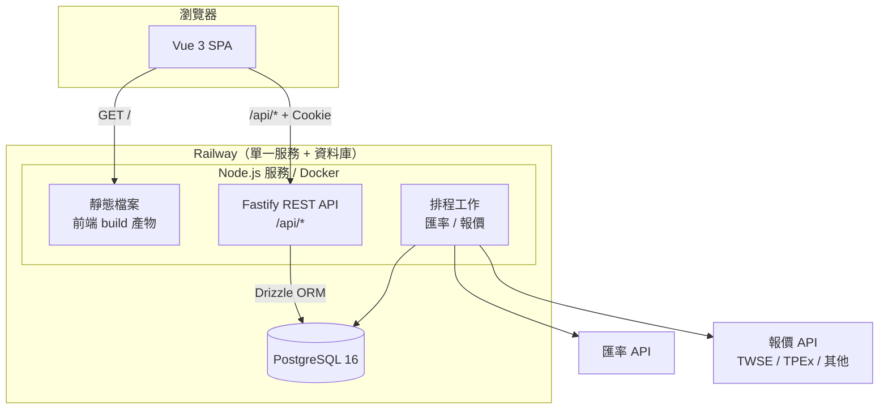
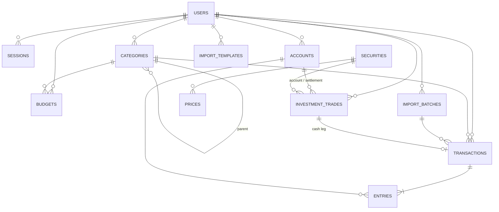
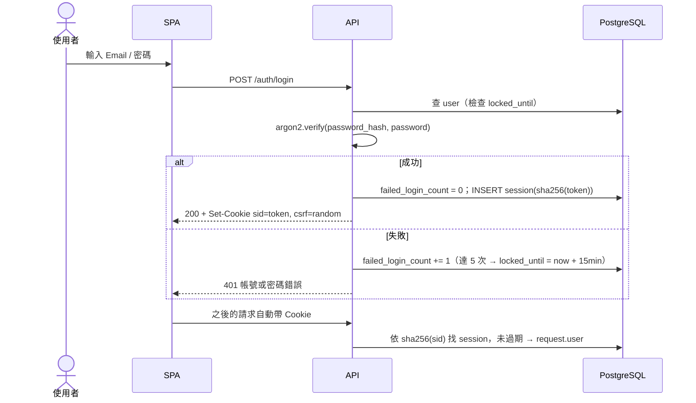
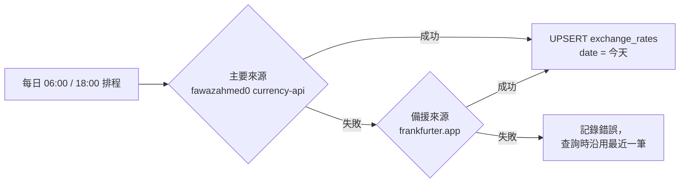
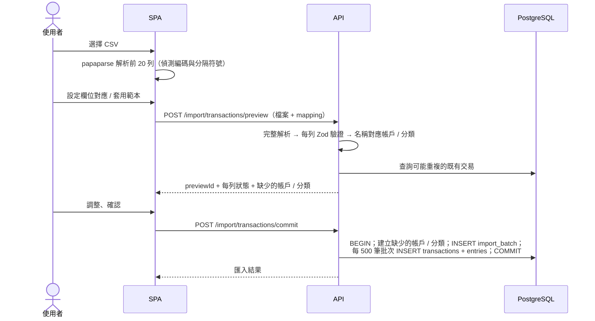
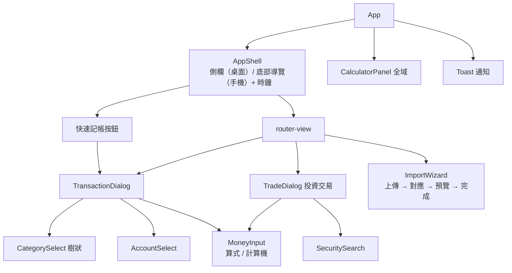
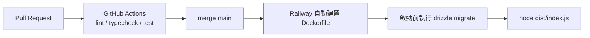

# 系統設計文件（SD — System Design）

# do-accounts 個人記帳理財系統（新版）

| 項目 | 內容 |
|---|---|
| 文件版本 | 0.1（草案，待確認） |
| 系統版本 | 2.0.0（規劃中） |
| 撰寫日期 | 2026-11-09 |
| 文件性質 | 系統設計（SD） |
| 相關文件 | [SA.md（系統分析文件）](./SA.md) |

> 本文件的技術選型是**提案**，理由與替代方案見第 9 章 ADR。確認後再開始實作。

---

## 1. 系統架構設計

### 1.1 整體架構

前端 SPA 與後端 API 打包成同一個服務、同源部署。這樣 Session Cookie 不會遇到跨站限制（Safari 等瀏覽器會擋第三方 Cookie），也不需要設定 CORS。



### 1.2 技術棧（提案）

| 層 | 技術 | 說明 |
|---|---|---|
| Monorepo | pnpm workspaces | `apps/web`、`apps/api`、`packages/shared` |
| 語言 | TypeScript 5（strict） | 前後端共用型別 |
| 驗證 schema | Zod | 定義在 `packages/shared`，前端表單與後端 API 共用 |
| 前端框架 | Vue 3（Composition API、`<script setup>`）＋ Vite | 延續舊版熟悉的框架 |
| 路由 | Vue Router（history 模式） | 同源部署，後端對非 `/api` 路徑回 `index.html` |
| 伺服器狀態 | TanStack Query（Vue Query） | 快取、重新抓取、樂觀更新；取代舊版手寫的 store 載入邏輯 |
| 用戶端狀態 | Pinia | 只放 UI 狀態（主題、計算機、篩選條件） |
| UI | Tailwind CSS v4 ＋ Reka UI（無樣式元件） | 對話框、下拉選單、日期選擇器的無障礙行為 |
| 圖表 | ECharts（vue-echarts） | 圓餅圖下鑽、大量資料點效能較好 |
| 金額計算 | decimal.js | 前端顯示與即時計算 |
| 後端框架 | Fastify 5 | 效能好、內建 schema 驗證、外掛生態完整 |
| ORM／Migration | Drizzle ORM ＋ drizzle-kit | 偏 SQL 寫法，統計聚合查詢好寫 |
| 資料庫 | PostgreSQL 16 | ACID transaction、`NUMERIC`、`DATE`、視窗函式 |
| 驗證 | 自建 Session（DB 表）＋ `@node-rs/argon2` | 可撤銷、可列出裝置；不使用 JWT |
| 排程 | `node-cron`（同一程序內） | 單一實例部署，夠用 |
| CSV | papaparse（前端解析預覽）、`csv-stringify`（後端匯出） | |
| 測試 | Vitest（單元／整合）、Playwright（E2E）、Testcontainers（PostgreSQL） | |
| 程式品質 | ESLint、Prettier、`vue-tsc` | |
| CI | GitHub Actions | lint → typecheck → test → build image |
| 部署 | Docker → Railway（App ＋ PostgreSQL） | |

### 1.3 目錄結構

```
do-accounts/
├── apps/
│   ├── web/                        # 前端
│   │   ├── src/
│   │   │   ├── main.ts
│   │   │   ├── App.vue
│   │   │   ├── router/             # 路由與登入守衛
│   │   │   ├── api/                # fetch 封裝 + 各資源 API 函式
│   │   │   ├── queries/            # Vue Query hooks（useAccounts, useTransactions…）
│   │   │   ├── stores/             # Pinia：ui / calculator / filters
│   │   │   ├── features/           # 依功能分資料夾
│   │   │   │   ├── auth/
│   │   │   │   ├── dashboard/
│   │   │   │   ├── accounts/
│   │   │   │   ├── transactions/
│   │   │   │   ├── categories/
│   │   │   │   ├── budgets/
│   │   │   │   ├── reports/
│   │   │   │   ├── investments/
│   │   │   │   ├── import-export/
│   │   │   │   └── settings/
│   │   │   ├── components/         # 共用元件（MoneyInput, Calculator, AppShell…）
│   │   │   ├── composables/
│   │   │   └── utils/              # money 格式化、日期工具
│   │   └── vite.config.ts
│   └── api/                        # 後端
│       ├── src/
│       │   ├── server.ts           # Fastify 建立與外掛註冊
│       │   ├── index.ts            # 啟動（listen + 排程）
│       │   ├── config.ts           # 環境變數（Zod 驗證）
│       │   ├── db/
│       │   │   ├── schema/         # Drizzle 資料表定義
│       │   │   ├── migrations/
│       │   │   └── seed.ts         # 新使用者預設資料
│       │   ├── plugins/            # auth、csrf、error handler、rate limit
│       │   ├── modules/            # 每個模組：routes.ts / service.ts / repo.ts
│       │   │   ├── auth/
│       │   │   ├── accounts/
│       │   │   ├── categories/
│       │   │   ├── transactions/
│       │   │   ├── budgets/
│       │   │   ├── reports/
│       │   │   ├── fx/
│       │   │   ├── investments/
│       │   │   └── import-export/
│       │   ├── jobs/               # 匯率、報價、Session 清理
│       │   └── lib/                # money、date、errors
│       └── test/
├── packages/
│   └── shared/                     # Zod schema、型別、列舉、幣別定義
├── docs/                           # SA / SD / ADR
├── docker-compose.yml              # 本機 PostgreSQL
├── Dockerfile
├── .github/workflows/ci.yml
└── pnpm-workspace.yaml
```

後端每個模組固定分三層：`routes`（HTTP、驗證輸入輸出）→ `service`（商業邏輯、transaction 邊界）→ `repo`（SQL）。所有 repo 函式的第一個參數都是 `userId`，在結構上保證資料隔離。

---

## 2. 資料庫設計

### 2.1 共通慣例

- 主鍵：`uuid`（`gen_random_uuid()`），避免舊版 `max + 1` 配號的競爭問題，也不洩漏資料筆數。
- 金額：`NUMERIC(19,4)`；匯率：`NUMERIC(20,10)`；股數：`NUMERIC(20,6)`（支援零股與基金單位）。
- 日期：交易日用 `DATE`（沒有時區問題）；時間戳記用 `TIMESTAMPTZ`。
- 每張業務資料表都有 `user_id`、`created_at`、`updated_at`。
- 幣別：ISO 4217 代碼（`TWD`，不再用舊版的 `NTD`）。

### 2.2 驗證相關

**users**

| 欄位 | 型別 | 說明 |
|---|---|---|
| id | uuid PK | |
| email | citext UNIQUE | 不分大小寫 |
| password_hash | text | Argon2id |
| display_name | text | |
| role | text | `user` / `admin` |
| base_currency | char(3) | 預設 `TWD` |
| settings | jsonb | 每週起始日、預算警示門檻、主題等 |
| failed_login_count | int | |
| locked_until | timestamptz NULL | |

**sessions**

| 欄位 | 型別 | 說明 |
|---|---|---|
| id | text PK | 32 bytes 隨機值的 SHA-256；Cookie 存原值，DB 只存雜湊 |
| user_id | uuid FK | |
| expires_at | timestamptz | 每次請求滑動延長（每小時最多更新一次） |
| user_agent / ip | text | 裝置清單顯示用 |
| last_used_at | timestamptz | |

**app_settings**：`key text PK, value jsonb`（例如 `allow_registration`）。

### 2.3 帳務核心

**accounts**

| 欄位 | 型別 | 說明 |
|---|---|---|
| id | uuid PK | |
| user_id | uuid FK | |
| name | text | 同使用者內唯一 |
| kind | text | `cash` / `bank` / `credit_card` / `e_wallet` / `investment` / `loan` / `other` |
| currency | char(3) | 有分錄後不可變更 |
| opening_balance | numeric(19,4) | 初始餘額 |
| opening_date | date | 資產趨勢起算日 |
| sort_order | int | 同 kind 內排序 |
| is_visible | bool | 首頁顯示 |
| archived_at | timestamptz NULL | 封存 |
| credit_limit / statement_day / due_day | numeric / smallint / smallint | 信用卡專用 |
| note | text | |

**categories**

| 欄位 | 型別 | 說明 |
|---|---|---|
| id | uuid PK | |
| user_id | uuid FK | |
| kind | text | `income` / `expense` |
| parent_id | uuid NULL FK → categories | 只允許兩層（CHECK 加 trigger 驗證） |
| name | text | 同上層內唯一 |
| icon / color | text | |
| sort_order | int | |
| system_key | text NULL | `other` / `adjustment` / `fee` / `investment_pnl`；非空值者不可刪除 |

**transactions**（使用者看到的一筆交易）

| 欄位 | 型別 | 說明 |
|---|---|---|
| id | uuid PK | |
| user_id | uuid FK | |
| kind | text | `income` / `expense` / `transfer` / `investment`（`investment` 只由投資交易產生） |
| date | date | 索引 `(user_id, date DESC)` |
| title | text | 項目名稱；建 `pg_trgm` 索引供搜尋 |
| category_id | uuid NULL FK | 轉帳、投資交割為 NULL；收支必填（CHECK） |
| fee_category_id | uuid NULL FK | 轉帳手續費的支出分類（預設系統分類「手續費」） |
| note | text | |
| tags | text[] | GIN 索引 |
| import_batch_id | uuid NULL FK | |
| investment_trade_id | uuid NULL FK | 由投資交易產生的現金交易 |

**entries**（分錄，帳戶餘額的唯一來源）

| 欄位 | 型別 | 說明 |
|---|---|---|
| id | uuid PK | |
| transaction_id | uuid FK ON DELETE CASCADE | |
| user_id | uuid FK | 冗餘欄位，方便直接聚合 |
| account_id | uuid FK | |
| amount | numeric(19,4) | 帳戶幣別、有正負號；流入為正、流出為負 |
| date | date | 冗餘自 transaction，避免統計時 JOIN |
| role | text | `main` / `transfer_out` / `transfer_in` / `fee` / `settlement` |

索引：`(account_id, date)`、`(user_id, date)`。

各交易類型的分錄規則（在 service 層驗證）：

| kind | 分錄 |
|---|---|
| expense | 1 筆 `main`，amount < 0 |
| income | 1 筆 `main`，amount > 0 |
| transfer | `transfer_out`（< 0）＋ `transfer_in`（> 0），兩個帳戶不同；選填 1 筆 `fee`（< 0，記在轉出帳戶） |
| investment | 1 筆 `settlement`（買進 < 0、賣出 > 0），記在交割帳戶；另一邊是持倉，由 `investment_trades` 表示 |

> 轉帳手續費屬於支出，統計時 `fee` 分錄計入 `fee_category_id` 指定的支出分類。`settlement` 分錄只是資產形式轉換（現金 ↔ 股票），不計入收支。

**帳戶餘額查詢**

```sql
SELECT a.id, a.opening_balance + COALESCE(SUM(e.amount), 0) AS balance
FROM accounts a
LEFT JOIN entries e ON e.account_id = a.id
WHERE a.user_id = $1
GROUP BY a.id;
```

個人規模（數萬筆分錄）直接聚合就夠快。若之後有效能需求，再加上 `account_balances` 快取表，用 trigger 維護（見 ADR-04）。

**budgets**

| 欄位 | 型別 | 說明 |
|---|---|---|
| id | uuid PK | |
| user_id | uuid FK | |
| month | date | 一律存每月 1 日 |
| category_id | uuid NULL FK | NULL = 當月總預算；只能是支出分類 |
| amount | numeric(19,4) | 本位幣 |
| is_recurring | bool | 循環預算：沒有該月紀錄時沿用最近一筆 |

UNIQUE `(user_id, month, category_id)`（NULL 用 `NULLS NOT DISTINCT`）。

### 2.4 匯率

**exchange_rates**

| 欄位 | 型別 | 說明 |
|---|---|---|
| date | date | |
| base | char(3) | 被換算的幣別，例如 `USD` |
| quote | char(3) | 目標幣別，例如 `TWD` |
| rate | numeric(20,10) | 1 base = rate quote |
| source | text | `fawazahmed0` / `frankfurter` / `manual` |
| user_id | uuid NULL | 手動覆寫時填入；系統抓取的為 NULL（全站共用） |

PK `(date, base, quote, COALESCE(user_id, '00000000-...'))`。查詢時優先取使用者手動值。

### 2.5 投資

**securities**（全站共用）

| 欄位 | 型別 | 說明 |
|---|---|---|
| id | uuid PK | |
| market | text | `TW` / `TWO` / `US` / `FUND` / `CRYPTO` / `OTHER` |
| symbol | text | UNIQUE `(market, symbol)` |
| name | text | |
| currency | char(3) | |
| asset_type | text | `stock` / `etf` / `fund` / `bond` / `crypto` / `other` |

**investment_trades**

| 欄位 | 型別 | 說明 |
|---|---|---|
| id | uuid PK | |
| user_id | uuid FK | |
| account_id | uuid FK | 投資帳戶（kind = investment） |
| security_id | uuid FK | |
| kind | text | `buy` / `sell` / `cash_dividend` / `stock_dividend` / `split` / `fee` |
| date | date | |
| quantity | numeric(20,6) | 買賣、股票股利的股數；分割存比例 |
| price | numeric(19,6) | 證券幣別 |
| fee / tax | numeric(19,4) | |
| amount | numeric(19,4) | 交割金額（系統計算，可手動修正） |
| settlement_account_id | uuid FK | 現金進出的帳戶 |
| note | text | |

買進、賣出、現金股利、費用會同時產生一筆 `transactions`（`investment_trade_id` 指回來）與分錄，讓交割帳戶的現金餘額正確。買進、賣出產生 kind = `investment` 的交易（不計入收支）；現金股利產生 `income`、獨立費用產生 `expense` 交易，分類為系統分類「投資損益」。

**prices**

| 欄位 | 型別 | 說明 |
|---|---|---|
| security_id | uuid FK | |
| date | date | |
| close | numeric(19,6) | |
| source | text | |

PK `(security_id, date)`。

**持倉計算**：不存持倉表，由 `investment_trades` 依日期順序計算（移動平均成本法），結果以 Vue Query 快取在前端、以記憶體 LRU 快取在後端（交易異動時失效）。演算法見 4.5。

### 2.6 匯入

**import_batches**：`id, user_id, file_name, row_count, imported_count, skipped_count, status (pending/completed/reverted), created_at, reverted_at`

**import_templates**：`id, user_id, name, mapping jsonb`（欄位對應、日期格式、正負號規則、預設帳戶、編碼）

### 2.7 ER 圖



---

## 3. API 設計

### 3.1 共通規範

- Base path：`/api/v1`
- 驗證：Session Cookie `sid`（`HttpOnly; Secure; SameSite=Lax; Path=/`）。除了 `/auth/login`、`/auth/register`、`/health`，其他端點都要登入。
- CSRF：非 GET 請求須帶 `X-CSRF-Token` 標頭（double-submit：值來自可讀 Cookie `csrf`）。
- 金額、匯率、股數一律以**字串**傳遞（例如 `"1234.50"`），避免 JSON 數字精度問題。
- 日期：`YYYY-MM-DD`；月份：`YYYY-MM`。
- 列表分頁：cursor 分頁 `?limit=50&cursor=<opaque>`，回傳 `{ items, nextCursor }`。
- 錯誤格式：

```json
{ "error": { "code": "VALIDATION_ERROR", "message": "金額必須大於 0", "details": [{ "path": "amount", "message": "..." }] } }
```

| HTTP | code | 情境 |
|---|---|---|
| 400 | `VALIDATION_ERROR` | 輸入格式錯誤（Zod） |
| 401 | `UNAUTHENTICATED` | 沒有或已過期的 Session |
| 403 | `FORBIDDEN` / `CSRF_INVALID` | 權限不足／CSRF 驗證失敗 |
| 404 | `NOT_FOUND` | 資源不存在或不屬於本人（兩者一律回 404） |
| 409 | `CONFLICT` | 名稱重複、帳戶有交易不能刪除等 |
| 422 | `BUSINESS_RULE` | 違反帳務規則（賣超、封存帳戶記帳…） |
| 429 | `RATE_LIMITED` | 登入嘗試過多 |

### 3.2 驗證 `/auth`

| 方法 | 路徑 | 說明 |
|---|---|---|
| POST | `/auth/register` | `{ email, password, displayName }`；檢查 `allow_registration`；第一個使用者成為 admin 並建立預設資料 |
| POST | `/auth/login` | `{ email, password }`；成功時設 Cookie，回傳使用者資料 |
| POST | `/auth/logout` | 刪除目前 Session |
| GET | `/auth/me` | 目前使用者與偏好設定 |
| PATCH | `/auth/me` | 修改顯示名稱、本位幣、偏好設定 |
| POST | `/auth/change-password` | `{ currentPassword, newPassword }`；撤銷其他 Session |
| GET | `/auth/sessions` | 登入裝置清單 |
| DELETE | `/auth/sessions/:id` | 登出指定裝置 |

### 3.3 帳戶 `/accounts`

| 方法 | 路徑 | 說明 |
|---|---|---|
| GET | `/accounts` | 含即時 `balance`、`balanceInBase`；`?includeArchived=true` |
| POST | `/accounts` | 新增 |
| GET | `/accounts/:id` | 單一帳戶 |
| PATCH | `/accounts/:id` | 部分更新；有分錄時改 `currency` → 409 |
| DELETE | `/accounts/:id` | 有分錄 → 409（請改用封存） |
| POST | `/accounts/:id/archive`、`/unarchive` | 封存／取消封存 |
| PUT | `/accounts/order` | `{ ids: string[] }` 依陣列順序重設 `sort_order` |
| GET | `/accounts/:id/balance-history?from&to` | 每日餘額（帳戶頁走勢圖） |

### 3.4 交易 `/transactions`

| 方法 | 路徑 | 說明 |
|---|---|---|
| GET | `/transactions` | 篩選：`from, to, accountId[], categoryId[], kind[], tag[], q, minAmount, maxAmount`；cursor 分頁；回傳含 `entries` 與每日小計 |
| POST | `/transactions` | 新增，body 見下方 |
| GET | `/transactions/:id` | |
| PUT | `/transactions/:id` | 整筆取代（重建分錄） |
| DELETE | `/transactions/:id` | 由投資交易產生的不可直接刪除（422，請從投資交易刪） |
| POST | `/transactions/bulk-delete` | `{ ids }` |
| POST | `/transactions/bulk-update` | `{ ids, categoryId?, tags? }` |
| GET | `/transactions/suggestions?q=` | 依項目名稱回傳常用分類與帳戶 |
| GET | `/transactions/export.csv` | 參數同列表篩選 |

新增交易的 request body（以 discriminated union 定義在 shared）：

```ts
type CreateTransaction =
  | { kind: 'expense' | 'income'; date: string; title: string; note?: string; tags?: string[];
      categoryId: string; accountId: string; amount: string }          // amount 為正數
  | { kind: 'transfer'; date: string; title?: string; note?: string; tags?: string[];
      fromAccountId: string; toAccountId: string;
      amount: string;                 // 轉出金額（轉出帳戶幣別）
      toAmount?: string;              // 跨幣別必填（轉入帳戶幣別）
      fee?: { amount: string; categoryId?: string } };
```

### 3.5 分類 `/categories`

| 方法 | 路徑 | 說明 |
|---|---|---|
| GET | `/categories` | 樹狀結構，依 kind 分組 |
| POST | `/categories` | |
| PATCH | `/categories/:id` | 不能改 `kind`；`parent_id` 只能指向同 kind 的頂層分類 |
| DELETE | `/categories/:id?moveTo=<id>` | 有交易時必須帶 `moveTo`；系統分類 → 409 |
| PUT | `/categories/order` | 排序 |

### 3.6 預算 `/budgets`

| 方法 | 路徑 | 說明 |
|---|---|---|
| GET | `/budgets?month=YYYY-MM` | 回傳當月有效預算（含循環沿用），每筆含 `spent`、`remaining`、`percentage`、`projected` |
| PUT | `/budgets` | Upsert `{ month, categoryId \| null, amount, isRecurring }` |
| DELETE | `/budgets/:id` | |
| POST | `/budgets/copy` | `{ fromMonth, toMonth }` |

### 3.7 報表 `/reports`

| 方法 | 路徑 | 回傳 |
|---|---|---|
| GET | `/reports/dashboard` | 淨資產、本月收支、預算概況、最近交易（首頁一次取得） |
| GET | `/reports/net-worth?from=YYYY-MM&to=YYYY-MM` | `[{ month, assets, liabilities, investments, netWorth }]` |
| GET | `/reports/category-breakdown?from&to&kind` | 分類樹與金額、百分比 |
| GET | `/reports/daily?month=` | `[{ date, income, expense }]` ＋ 總計 |
| GET | `/reports/category-trend?categoryId&months=12` | `[{ month, amount }]` |

### 3.8 匯率 `/fx`

| 方法 | 路徑 | 說明 |
|---|---|---|
| GET | `/fx/latest` | 各支援幣別對本位幣的最新匯率與日期 |
| GET | `/fx/history?currency&from&to` | 歷史匯率 |
| PUT | `/fx/manual` | `{ date, currency, rate }` 使用者手動覆寫 |

### 3.9 投資 `/investments`

| 方法 | 路徑 | 說明 |
|---|---|---|
| GET | `/investments/securities/search?q=&market=` | 先查本地資料表，再查外部來源 |
| POST | `/investments/securities` | 手動建立證券 |
| GET | `/investments/holdings?accountId=` | 持倉：股數、均價、成本、現價、市值、未實現損益、報酬率 |
| GET | `/investments/summary` | 全部投資帳戶的市值、損益、股利總計與配置比例 |
| GET | `/investments/trades?accountId&securityId&from&to` | 交易列表（cursor 分頁） |
| POST | `/investments/trades` | 新增；同時產生現金交易 |
| PUT | `/investments/trades/:id` | 更新；同步更新現金交易 |
| DELETE | `/investments/trades/:id` | 刪除；連同現金交易一起刪 |
| GET | `/investments/realized?year=` | 已實現損益明細 |
| PUT | `/investments/prices` | `{ securityId, date, close }` 手動報價 |
| GET | `/investments/trades/export.csv` | 匯出 |

### 3.10 匯入匯出 `/import`、`/export`

| 方法 | 路徑 | 說明 |
|---|---|---|
| POST | `/import/transactions/preview` | multipart 上傳 CSV ＋ mapping；回傳每列解析結果（`ok` / `duplicate` / `error` ＋ 原因）、待建立的帳戶與分類；結果暫存 30 分鐘，回傳 `previewId` |
| POST | `/import/transactions/commit` | `{ previewId, rowOverrides?, createMissing: { accounts, categories } }`；回傳 `ImportBatch` |
| GET | `/import/batches` | 匯入紀錄 |
| POST | `/import/batches/:id/revert` | 整批撤銷 |
| GET / POST / PUT / DELETE | `/import/templates[/:id]` | 匯入範本 CRUD |
| POST | `/import/investment-trades/preview`、`/commit` | 投資交易匯入（同樣流程） |
| GET | `/export/backup.json` | 完整備份 |
| POST | `/import/backup` | 從 JSON 還原（僅限沒有任何交易的帳號） |

### 3.11 管理 `/admin`（限 admin）

| 方法 | 路徑 | 說明 |
|---|---|---|
| GET / PATCH | `/admin/settings` | `allow_registration` 等 |
| GET | `/admin/users` | 使用者清單 |
| POST | `/admin/jobs/:name/run` | 手動觸發匯率／報價排程 |

### 3.12 其他

- `GET /health`：資料庫連線檢查，供 Railway 健康檢查使用。

---

## 4. 核心模組設計

### 4.1 驗證與 Session（`modules/auth`）



- `authPlugin` 在 `onRequest` hook 解析 Session，把 `request.user` 注入；路由宣告 `config: { public: true }` 才能跳過驗證。
- 密碼規則：至少 10 個字元；檢查是否和 Email 相同。
- IP 層級另外用 `@fastify/rate-limit` 限制 `/auth/*`：每 IP 每分鐘 10 次。
- 排程每天清除過期 Session。

### 4.2 交易服務（`modules/transactions/service.ts`）

所有寫入都在 `db.transaction()` 內完成：

```
createTransaction(userId, input):
  1. 驗證帳戶與分類都屬於 userId、帳戶未封存、分類 kind 與交易 kind 一致
  2. 轉帳：fromAccountId ≠ toAccountId
           幣別相同 → toAmount 必須省略或等於 amount
           幣別不同 → toAmount 必填
  3. 依 kind 產生分錄（見 2.3 規則表），金額依帳戶幣別四捨五入到該幣別小數位
  4. INSERT transactions；INSERT entries
  5. 使相關快取失效（持倉、報表）

updateTransaction(userId, id, input):
  在同一個 transaction 內：驗證 → UPDATE transactions → DELETE entries WHERE transaction_id → INSERT 新分錄

deleteTransaction(userId, id):
  investment_trade_id 不為 NULL → 422
  DELETE transactions（entries 以 CASCADE 刪除）
```

不需要舊版的 apply／revert 和「同步資料」：餘額永遠是查詢結果。

### 4.3 金額處理（`packages/shared/money.ts`）

- 幣別設定表：`{ TWD: { digits: 0, symbol: 'NT$' }, JPY: { digits: 0, symbol: '¥' }, USD: { digits: 2, symbol: '$' } }`，新增幣別只要改這張表。
- 後端：PostgreSQL 做加總，應用層用 `decimal.js` 計算，不使用 JS `number` 處理金額。
- 前端：`MoneyInput` 元件接受算式（`120+35*2`），用安全的運算式解析器（不用 `eval`）算出結果後轉成 decimal 字串。
- 換算成本位幣後的結果保留 4 位小數，顯示時依本位幣位數四捨五入。

### 4.4 匯率服務（`modules/fx`）



對外只提供一個介面：

```ts
interface FxService {
  getRate(currency: string, onDate: string, userId: string): Promise<Decimal>;   // 1 currency = ? base
  convert(amount: Decimal, from: string, onDate: string, userId: string): Promise<Decimal>;
  getRatesForRange(currencies: string[], from: string, to: string, userId: string): Promise<RateTable>;
}
```

- 取「`date <= onDate` 中最新的一筆」，手動值優先。
- 報表一次載入整個期間的匯率表（`getRatesForRange`），在記憶體查找，避免 N+1。
- 某幣別完全沒有匯率紀錄時，啟動時用內建的初始匯率表寫入一筆種子資料。
- 本位幣與交易幣別相同時直接回傳 1。

### 4.5 投資計算（`modules/investments/holdings.ts`）

採移動平均成本法，以純函式實作，方便單元測試：

```
for trade in trades（依 date, created_at 排序）:
  buy:            cost += qty × price + fee + tax（買進稅通常為 0）
                  qty_held += qty
  sell:           若 qty > qty_held → 錯誤（寫入時就擋掉）
                  avg = cost / qty_held
                  realized += qty × price − fee − tax − qty × avg
                  cost −= qty × avg；qty_held −= qty
  cash_dividend:  dividends += amount
  stock_dividend: qty_held += qty（成本不變，均價下降）
  split:          qty_held ×= ratio
  fee:            cost += amount
市值 = qty_held × 最新收盤價
未實現損益 = 市值 − cost
報酬率 = (未實現 + 已實現 + 股利) / 累計投入成本
```

- 寫入時重算該證券的持倉，若任何時間點股數變成負值就拒絕（含修改歷史交易的情況）。
- 交割金額預設值：台股買進 = 股數 × 價格 + 手續費（`max(20, 成交金額 × 0.1425%)`，可設定折扣）；台股賣出另扣證交稅 0.3%（ETF 0.1%）。系統只帶入預設值，使用者可以修改。
- 資產趨勢中，各月月底的投資市值 = 該月底持股 × 該日（或之前最近）收盤價 × 該日匯率。

**報價來源（`QuoteProvider` 介面，可替換）**

| 市場 | 第一版來源 | 說明 |
|---|---|---|
| TW（上市） | TWSE OpenAPI（每日收盤） | 免金鑰 |
| TWO（上櫃） | TPEx OpenAPI | 免金鑰 |
| US／其他 | 手動輸入 | 外部來源依 SA R-2 另行評估後加入 |

排程：台股週一到週五 14:30（收盤後）抓取「有持倉的證券」報價。

### 4.6 CSV 匯入流程（`modules/import-export`）



- 重複偵測鍵：`(date, account_id, amount)` 相同，且 `title` 的 trigram 相似度 ≥ 0.6。
- 金額正負規則：可選「單一金額欄、負數為支出」或「收入欄與支出欄分開」。
- 編碼：支援 UTF-8 與 Big5（台灣銀行常見），用 `iconv-lite` 轉換。
- 預覽結果暫存在 PostgreSQL `UNLOGGED` 表，30 分鐘到期，不放記憶體（避免服務重啟後遺失）。
- 撤銷：`DELETE FROM transactions WHERE import_batch_id = $1 AND user_id = $2`，並把批次標記為 `reverted`。

**匯出 CSV 欄位**：`日期, 類型, 項目, 大類, 子類, 帳戶, 金額, 幣別, 轉入帳戶, 轉入金額, 標籤, 備註`。輸出 UTF-8 with BOM，用串流寫出（大量資料不會占用大量記憶體）。這個格式也能直接再匯入（內建範本「do-accounts 格式」）。

### 4.7 報表演算法（`modules/reports`）

**淨資產趨勢**（單一 SQL ＋ 應用層換算）：

```sql
-- 各帳戶在各月月底的餘額
WITH months AS (
  SELECT (date_trunc('month', m) + interval '1 month - 1 day')::date AS month_end
  FROM generate_series($from::date, $to::date, interval '1 month') m
)
SELECT m.month_end, a.id, a.currency,
       a.opening_balance + COALESCE(SUM(e.amount) FILTER (WHERE e.date <= m.month_end), 0) AS balance
FROM months m
CROSS JOIN accounts a
LEFT JOIN entries e ON e.account_id = a.id
WHERE a.user_id = $1 AND a.opening_date <= m.month_end
GROUP BY m.month_end, a.id;
```

之後在應用層用各月月底的匯率換算成本位幣，加上投資市值，再依正負分為資產與負債（信用卡、貸款帳戶固定算負債）。當月的月底點以今天代替。

**收支統計**：以 `entries` JOIN `transactions` 聚合，只計 `main` 與 `fee` 分錄（排除 `transfer_in` / `transfer_out` / `settlement`）；外幣以交易日匯率換算。

### 4.8 前端計算機（沿用舊版設計）

- 全域浮動、可拖曳（pointer events 同時支援滑鼠和觸控）、鍵盤輸入（數字、`+ - * / .`、Enter、Backspace、`c`、Esc）。
- 改用 decimal 計算，不再需要 `Math.round(x * 1e8) / 1e8`。
- 透過 Pinia `calculator` store 開啟，帶入目標用 callback 指定，任何 `MoneyInput` 都能呼叫。

---

## 5. 前端設計

### 5.1 路由（history 模式）

| 路徑 | 頁面 | 說明 |
|---|---|---|
| `/login`、`/register` | 登入／註冊 | 公開頁面 |
| `/` | 總覽 | 淨資產三卡、帳戶分組（拖曳排序）、本月收支與預算、最近交易 |
| `/transactions` | 明細 | 篩選列（同步到 URL query，可分享、可返回）、日期分組列表、無限捲動、批次操作 |
| `/accounts`、`/accounts/:id` | 帳戶 | 帳戶管理；單一帳戶頁顯示餘額走勢與該帳戶明細 |
| `/categories` | 分類 | 收入／支出兩個頁籤，樹狀拖曳排序 |
| `/budgets` | 預算 | 月份切換、總預算與各分類進度條、複製上月 |
| `/reports` | 報表 | 子頁籤：淨資產、收支結構、每日、分類趨勢 |
| `/investments`、`/investments/:accountId` | 投資 | 總覽（配置圖、總損益）、帳戶持倉、交易紀錄 |
| `/import` | 匯入 | 步驟式精靈 ＋ 匯入紀錄 |
| `/settings` | 設定 | 個人資料、偏好、密碼、裝置、匯率、匯出備份、管理者設定 |

路由守衛：`meta.public` 以外的頁面，若 `GET /auth/me` 回 401，就導向 `/login?redirect=<原路徑>`。API 封裝層收到任何 401 時清除快取並導向登入頁。

### 5.2 狀態管理

| 類別 | 工具 | 內容 |
|---|---|---|
| 伺服器資料 | Vue Query | `useAccounts`、`useTransactions(filters)`、`useCategories`、`useBudgets(month)`、`useHoldings`、`useReports*`、`useFxLatest` |
| 用戶端狀態 | Pinia | `ui`（主題、側欄）、`calculator`、`session`（目前使用者） |

- 新增或修改交易成功後，讓 `accounts`、`transactions`、`reports`、`budgets` 的查詢失效並重新抓取。
- 帳戶顯示切換、拖曳排序用樂觀更新，失敗時回滾（沿用舊版行為）。

### 5.3 主要元件



### 5.4 響應式與主題

- 斷點：`< 768px` 手機（卡片列表、底部導覽、全螢幕對話框）；`≥ 768px` 桌面（表格、側欄）。
- 深色模式：Tailwind `dark:` ＋ CSS 變數；圖表主題跟著切換。
- 收入綠色、支出紅色（可在設定中對調，以配合「台股紅漲綠跌」習慣的使用者）。

---

## 6. 部署與環境設計

### 6.1 環境

| 環境 | 前端 | 後端 | 資料庫 |
|---|---|---|---|
| 本機開發 | Vite dev server :5173（proxy `/api` → :3000） | `tsx watch` :3000 | Docker Compose PostgreSQL :5432 |
| CI 測試 | — | Vitest ＋ Testcontainers | 臨時 PostgreSQL 容器 |
| 正式 | 由 API 服務提供靜態檔 | Railway Docker 服務 | Railway PostgreSQL |

### 6.2 建置與部署流程



Dockerfile 採多階段建置：`pnpm install` → build `shared` → build `web` → build `api` → 正式階段只複製 `api/dist`、`web/dist` 與正式依賴。

### 6.3 環境變數（後端，啟動時以 Zod 驗證，缺少就拒絕啟動）

| 變數 | 說明 |
|---|---|
| `DATABASE_URL` | PostgreSQL 連線字串 |
| `PORT` | 預設 3000 |
| `NODE_ENV` | `development` / `production` |
| `SESSION_SECRET` | Cookie 簽章用，≥ 32 字元 |
| `APP_ORIGIN` | 例如 `https://do-accounts.up.railway.app`，用於 Cookie 與 CSRF 來源檢查 |
| `ALLOW_REGISTRATION` | 初始值；之後以 `app_settings` 為準 |
| `TZ` | `Asia/Taipei`（排程時間與「今天」的判定） |

前端不需要 `VITE_API_URL`：同源部署，一律呼叫相對路徑 `/api/v1`。

### 6.4 本機開發指令（規劃）

```bash
docker compose up -d db
pnpm install
pnpm db:migrate
pnpm dev          # 同時啟動 web 與 api
```

---

## 7. 安全性與品質設計

### 7.1 安全性

| 面向 | 設計 |
|---|---|
| 驗證 | Argon2id（memory 19MB、iterations 2）；Session token 32 bytes 隨機值，DB 只存 SHA-256 |
| Cookie | `HttpOnly; Secure; SameSite=Lax`；登入成功時重新產生 Session（防止 Session fixation） |
| CSRF | double-submit token ＋ 檢查 `Origin` 標頭等於 `APP_ORIGIN` |
| 暴力破解 | 帳號層級鎖定（5 次 / 15 分鐘）＋ IP 層級限流 |
| 授權 | repo 函式強制帶 `userId`；別人的資源一律回 404；整合測試逐一驗證每個端點的跨使用者存取 |
| 輸入驗證 | 所有輸入經 Zod schema；SQL 一律參數化（Drizzle） |
| 標頭 | `@fastify/helmet`（CSP、HSTS、X-Content-Type-Options） |
| 上傳 | CSV 限制 5MB、只接受 `text/csv`；不寫入檔案系統 |
| CSV 匯出 | 開頭為 `= + - @` 的儲存格加上 `'` 前綴，防止 CSV injection |
| 日誌 | pino 結構化日誌；遮蔽密碼、Cookie、token 欄位 |

### 7.2 測試策略

| 層級 | 範圍 | 工具 |
|---|---|---|
| 單元 | 分錄產生規則、金額四捨五入、持倉計算、匯率查找、CSV 解析與重複偵測、運算式解析器 | Vitest |
| 整合 | 每個 API 端點（含 401 / 404 跨使用者 / 422 規則）、DB transaction 回滾 | Vitest ＋ Testcontainers PostgreSQL |
| E2E | 註冊 → 建帳戶 → 記帳 → 轉帳 → 預算 → 報表；投資買賣；CSV 匯入與撤銷 | Playwright |
| 帳務不變式 | 隨機產生大量交易後，驗證「所有分錄加總 = 所有帳戶餘額變化」、「轉帳不影響總收支」 | Vitest（property-based，fast-check） |

---

## 8. 開發階段規劃

| 階段 | 內容 | 完成標準 |
|---|---|---|
| Phase 0 基礎建設 | monorepo、Docker Compose、Drizzle schema 與 migration、Fastify 骨架、錯誤處理、CI | `pnpm dev` 可啟動，CI 全綠 |
| Phase 1 核心記帳 | 驗證（M1）、帳戶（M2）、分類（M4）、交易（M3）、首頁（M7 基本版）、計算機 | 可登入並完成日常記帳，取代舊版 |
| Phase 2 預算與報表 | 匯率（M7）、預算（M5）、報表（M6） | 舊版所有功能都已涵蓋 |
| Phase 3 匯入匯出 | CSV 匯出、匯入精靈、範本、撤銷、JSON 備份 | 能匯入一份實際的銀行對帳單 |
| Phase 4 投資 | 證券、投資交易、持倉、台股報價、淨資產整合 | 投資市值反映在首頁與趨勢圖 |
| Phase 5 打磨 | 深色模式、快捷鍵、PWA、效能調校 | — |

每個階段結束時部署到正式環境。

---

## 9. 設計決策紀錄（ADR 摘要）

| # | 決策 | 理由 | 替代方案與取捨 |
|---|---|---|---|
| ADR-01 | 資料庫改用 PostgreSQL | 記帳需要 ACID transaction（轉帳兩筆分錄要同時成功）、`NUMERIC` 精確金額、`DATE` 範圍查詢、聚合與視窗函式做報表 | MongoDB（舊版）：也支援 transaction，但聚合報表與型別約束較弱；SQLite：最簡單，但雲端平台持久化磁碟較麻煩 |
| ADR-02 | 交易＋分錄模型，餘額由分錄推導 | 單一真實來源，不需要 apply / revert 與重算；轉帳、跨幣別、手續費、投資交割全部統一處理 | 舊版即時增減餘額：讀取最快，但容易不一致；完整複式記帳（借貸科目）：最嚴謹，但對個人使用太複雜 |
| ADR-03 | 前後端同源部署（單一 Docker 服務） | httpOnly Cookie 不受第三方 Cookie 限制、不用 CORS、只要部署一個服務 | GitHub Pages ＋ 獨立 API（舊版）：前端免費，但跨站 Cookie 在 Safari 會被擋，只能改用 token 存 localStorage（較不安全） |
| ADR-04 | 餘額即時聚合，不建快取表 | 個人資料量（數萬筆）聚合只要數毫秒，邏輯最簡單 | 若效能不足，再加 trigger 維護的 `account_balances` 表 |
| ADR-05 | 資料庫 Session，不用 JWT | 可以立即撤銷、可以列出登入裝置、實作簡單 | JWT：無狀態，但無法撤銷，還要再做 refresh token 機制 |
| ADR-06 | Fastify ＋ Drizzle | Fastify 有內建 schema 驗證與完整外掛（cookie、rate-limit、helmet、multipart）；Drizzle 寫法接近 SQL，型別推導好，報表 SQL 好寫 | Express（舊版）：生態最大但需要自己組裝較多；NestJS：結構完整但對個人專案偏重；Prisma：好上手，但複雜聚合常要寫 raw SQL |
| ADR-07 | Vue 3 ＋ Vue Query ＋ Pinia | 延續舊版的 Vue 經驗；Vue Query 處理伺服器資料的快取與失效，減少大量手寫 store 程式碼 | Nuxt：SSR 對需要登入的記帳工具效益不大；React：需要重新學習 |
| ADR-08 | 匯率按日保存 | 歷史報表使用當時匯率，數字不會因為今天匯率變動而改變 | 只存最新匯率（舊版）：簡單但歷史數字不穩定 |
| ADR-09 | 持倉即時計算，不存持倉表 | 修改或刪除歷史交易後不會有持倉不同步的問題 | 存持倉快照：讀取快，但要處理修改歷史交易時的重算 |
| ADR-10 | 主鍵使用 UUID | 不需要 `max + 1` 配號（舊版有競爭問題），匯入與備份還原時不會發生 ID 衝突 | 自增整數：較短，但會洩漏筆數，備份還原時需重新對應 |
| ADR-11 | 不遷移舊版資料 | 使用者已確認從零開始 | 若之後需要，可寫一次性腳本：舊 MongoDB → 新版 JSON 備份格式 → 用備份還原匯入 |
