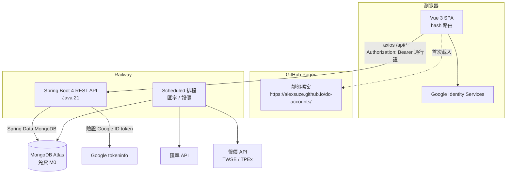
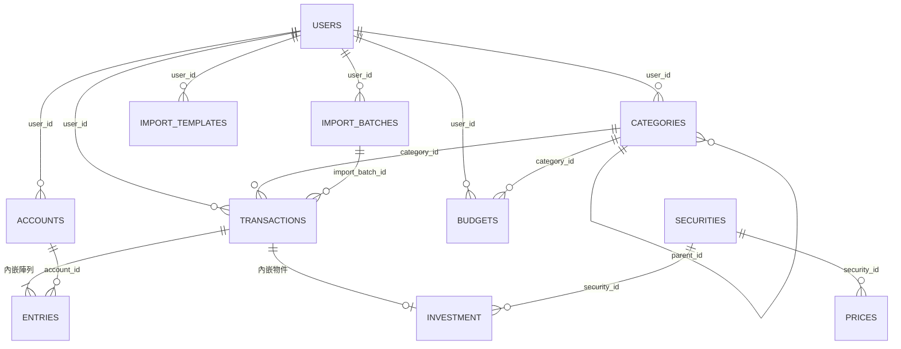
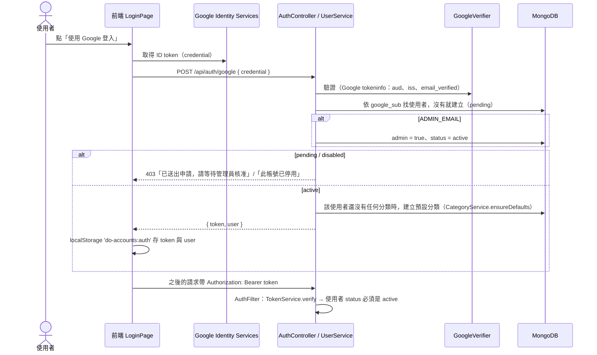
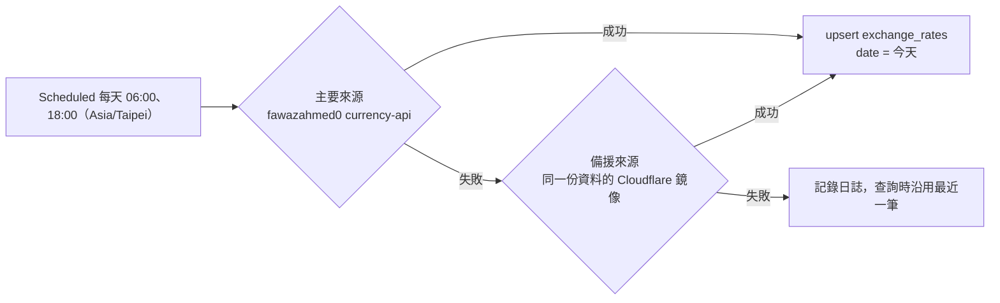
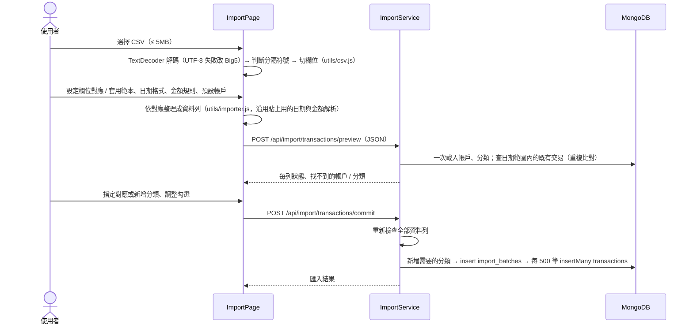

# 系統設計文件（SD — System Design）

# do-accounts 個人記帳理財系統（新版）

| 項目 | 內容 |
|---|---|
| 文件版本 | 0.5 |
| 系統版本 | 2.0.0（規劃中） |
| 撰寫日期 | 2026-11-09 |
| 文件性質 | 系統設計（SD） |
| 相關文件 | [SA.md（系統分析文件）](./SA.md) |
| 架構參考 | [alexsuze/to-do-schedule](https://github.com/alexsuze/to-do-schedule)（技術棧、目錄結構、登入、部署方式與其一致） |

> v0.2 變更：後端改為 Java（Spring Boot），整體技術架構比照 to-do-schedule。
> 資料庫因此改回 MongoDB Atlas，登入改為 Google 登入＋管理員核准。
> v0.5 變更：階段 3 實作——CSV 改在瀏覽器解析、取消 import_previews（2.9、4.7、ADR-17）、匯入匯出與備份 API 格式（3.10）。
>
> v0.4 變更：階段 2 實作——預算停止標記（2.7）、匯率以 TWD 為中介與來源改為 currency-api 鏡像（2.8、4.4）、預算／報表／匯率 API 回傳格式（3.6～3.8）、圖表改用自製 SVG（ADR-15、16）。
>
> v0.3 變更：頁面示意圖定案，UI 採 **Tailwind CSS v4 ＋ Reka UI**（不使用 Quasar），見 1.5 與第 5 章。
> 帳務核心設計（交易＋分錄、精確金額、每日匯率）維持不變，改以 MongoDB 的方式實作，見第 2 章。

---

## 1. 系統架構設計

### 1.1 整體架構

與 to-do-schedule 相同：前端是靜態網站，放在 GitHub Pages；後端是 Spring Boot API，放在 Railway；資料庫用 MongoDB Atlas 免費層。



### 1.2 技術棧

| 層 | 技術 | 與 to-do-schedule | 說明 |
|---|---|---|---|
| 前端建置 | Vite | 相同 | |
| 前端框架 | Vue 3（`<script setup>`，JavaScript） | 相同 | |
| 樣式 | Tailwind CSS v4（`@tailwindcss/vite`） | **不同**（to-do-schedule 用 Quasar） | 依示意圖自訂科技風格，設計 tokens 見 5.3 |
| 互動元件 | Reka UI（無樣式） | **新增** | 對話框、下拉選單、日期選擇、Toast 的鍵盤操作與無障礙 |
| 圖示 | lucide-vue-next | **新增** | 線條圖示 |
| 字體 | @fontsource（Space Grotesk、Inter、JetBrains Mono、Noto Sans TC） | **新增** | 自帶字體檔，不從外部載入 |
| 狀態管理 | Pinia | 相同 | 每個資源一個 store，負責呼叫 API 與快取清單 |
| 路由 | Vue Router，`createWebHashHistory` | 相同 | GitHub Pages 子路徑重新整理不會 404 |
| HTTP | axios（`services/api.js` 統一 instance） | 相同 | 自動帶通行證、401 自動回登入頁、統一顯示錯誤 |
| 拖曳 | vuedraggable | 相同 | 帳戶、分類排序 |
| 圖表 | 自製 SVG 元件（`components/charts/`） | **新增** | 依示意圖繪製，顏色直接用 CSS 變數，深淺色自動切換（ADR-15） |
| 金額計算（前端） | decimal.js-light | **新增** | 表單即時計算、加總顯示 |
| CSV 解析 | 自寫解析（`utils/csv.js`）＋ 瀏覽器 `TextDecoder`（UTF-8／Big5） | **新增** | 不引入套件；與貼上共用同一個解析器（ADR-17） |
| 後端語言 | Java 21 | 相同 | |
| 後端框架 | Spring Boot 4.1.x（webmvc、data-mongodb、validation、actuator） | 相同 | |
| 建置工具 | Maven Wrapper（`./mvnw`） | 相同 | 本機不需另裝 Maven |
| CSV（後端） | 只負責匯出（自寫，`ExportService`） | **新增** | 匯入的解析在前端（ADR-17） |
| 外部 HTTP | Spring `RestClient` | 相同 | Google、匯率、報價 |
| 排程 | `@EnableScheduling` ＋ `@Scheduled(zone = "Asia/Taipei")` | 相同 | |
| 資料庫 | MongoDB Atlas 免費層 | 相同 | |
| 登入 | Google 登入 ＋ 管理員核准 ＋ HMAC 通行證 | 相同 | 直接沿用 `AuthFilter`、`TokenService`、`GoogleVerifier`、`UserService` 的設計 |
| Email | Resend（選用） | 相同 | 新帳號申請通知管理員；之後可加每月報表 |
| 測試（後端） | JUnit 5 ＋ Mockito（service 單元測試，不需要 MongoDB） | 相同 | |
| 測試（前端） | Node 內建 `node --test`（`src/utils` 純函式） | 相同 | |
| 部署 | 前端 GitHub Actions → Pages；後端 Railway（Nixpacks，JDK 21） | 相同 | |

### 1.3 目錄結構（monorepo）

```
do-accounts/
├── docs/                         # SA、SD、開發進度
├── frontend/
│   ├── src/
│   │   ├── main.js               # Pinia、Router、主題初始化、載入 css/main.css
│   │   ├── App.vue
│   │   ├── router/index.js       # hash 路由、登入守衛、管理頁守衛
│   │   ├── layouts/MainLayout.vue # 側邊欄（桌面）/ 收合選單（手機）、時鐘、主題切換
│   │   ├── pages/                # 每個頁面一個檔案（見 5.1）
│   │   ├── components/           # 功能元件：TransactionDialog、TradeDialog、TransactionGrid…（5.5）
│   │   │   └── ui/               # 基礎元件：AppButton、AppDialog、MoneyInput、SegmentedControl…（5.5）
│   │   ├── stores/               # auth、accounts、categories、transactions、budgets、reports、investments、fx
│   │   ├── services/             # api.js、session.js
│   │   ├── utils/                # money.js、date.js、expr.js（算式計算）＋ *.test.js
│   │   └── css/main.css          # Tailwind 進入點、設計 tokens、深淺色變數（5.4）
│   ├── vite.config.js            # base 由 VITE_BASE_PATH 決定
│   ├── .env.example
│   └── package.json
├── backend/
│   ├── src/main/java/com/doaccounts/
│   │   ├── BackendApplication.java   # @EnableScheduling、@ConfigurationPropertiesScan
│   │   ├── config/               # AuthFilter、WebConfig（CORS）、MongoConfig、AppProperties、JacksonConfig、IndexInitializer
│   │   ├── controller/           # 每個資源一個 Controller，只做輸入輸出
│   │   ├── model/                # @Document 類別
│   │   ├── repository/           # MongoRepository 介面
│   │   └── service/              # 商業邏輯；複雜查詢用 MongoTemplate
│   ├── src/main/resources/application.properties
│   ├── src/test/java/com/doaccounts/service/   # 各 service 單元測試
│   ├── pom.xml
│   ├── railway.toml
│   ├── nixpacks.toml
│   └── .env.example
├── .github/workflows/deploy-frontend.yml
├── CLAUDE.md
└── README.md
```

### 1.4 共通慣例（比照 to-do-schedule）

- 所有 API 路徑以 `/api/` 開頭，回傳 JSON；**欄位一律 snake_case**（`spring.jackson.property-naming-strategy=SNAKE_CASE`），與 Mongo 欄位名稱相同。
- 前端一律透過 `services/api.js` 呼叫後端。
- Controller 用 `@RequestAttribute(AuthFilter.USER) User user` 取得目前使用者，並把 `user.id` 傳給 service；service 所有公開方法的第一個參數都是 `userId`。
- 別人的資料一律回 404「找不到」，不透露資料是否存在。
- 業務錯誤丟 `ResponseStatusException`，並帶中文訊息；回應格式為 RFC 9457 Problem Details（`spring.mvc.problemdetails.enabled=true`），訊息放在 `detail`。前端在 axios interceptor 統一用通知元件（toast）顯示。
- request／response 用 Java `record` 定義在對應的 service 內（例如 `TransactionService.TransactionRequest`）。
- 時間戳記以 UTC `Instant` 保存；**交易日期**以 `"YYYY-MM-DD"` 字串保存（理由見 2.1）。
- 不使用軟刪除：記帳資料刪除就是真的刪除（匯入可整批撤銷，資料可匯出備份）。

### 1.5 UI 方案（已定案）

示意圖確認後，UI 採 **Tailwind CSS v4 ＋ Reka UI**，不使用 Quasar（理由見 ADR-12）：

- 示意圖是自訂的科技風格（深色、青色主色、等寬數字、光暈），用 Tailwind 直接實作最貼近，不必覆寫元件庫的預設外觀。
- Tailwind 只負責樣式；對話框、下拉選單、日期選擇這類有複雜鍵盤操作的元件交給 Reka UI（無樣式），兼顧無障礙。
- 表格模式（多筆編輯）本來就要自建格子編輯，不依賴元件庫的表格。

設計 tokens、Tailwind 設定、元件清單見第 5 章。

---

## 2. 資料庫設計（MongoDB）

### 2.1 設計原則

1. **一次記帳只寫一份文件。** MongoDB 的單一文件寫入天生就是原子操作，所以把「交易」和它的「分錄」放在同一份文件裡（`entries` 陣列）。轉帳兩邊的金額必然同時成功或同時失敗，不需要多文件交易（multi-document transaction）。投資買賣也放在同一份交易文件裡，現金與持股同步。
2. **餘額由分錄推導。** 帳戶不存 `balance`；餘額 = `opening_balance` ＋ 所有交易中屬於該帳戶的分錄加總（aggregation）。不需要舊版的 apply／revert，也不需要「同步資料」。
3. **金額用 `Decimal128`。** Java 端用 `BigDecimal`，並在欄位加上 `@Field(targetType = FieldType.DECIMAL128)`（Spring Data 預設會把 `BigDecimal` 存成字串，無法加總，所以一定要指定）。API JSON 中，金額以**字串**輸出（`JacksonConfig` 把 `BigDecimal` 序列化成字串），避免 JavaScript 浮點誤差。
4. **交易日期存 `"YYYY-MM-DD"` 字串。** 記帳日期本身沒有時區，存成 `Date` 反而容易在 UTC 換算時跑到前一天。字串依字典順序就是日期順序，可以用 `$gte`／`$lte` 做範圍查詢並建索引（舊版的問題在於用正規表達式查月份，新版不再這樣做）。
5. **欄位 snake_case、主鍵 ObjectId**（Java 端為 `String id`），與 to-do-schedule 相同。
6. **索引在背景建立。** to-do-schedule 沒有建索引，因為開啟 `auto-index-creation` 後，本機沒有 MongoDB 時會無法啟動。記帳資料需要依日期與帳戶查詢，所以改用 `IndexInitializer`：伺服器啟動完成（`ApplicationReadyEvent`）後，在背景用 `MongoTemplate.indexOps().ensureIndex()` 建立索引；失敗只記錄日誌，不影響啟動。

### 2.2 users（比照 to-do-schedule，加上記帳偏好）

| 欄位 | 型別 | 說明 |
|---|---|---|
| _id | ObjectId | |
| google_sub | string | Google 帳號唯一 id |
| email / name / picture | string | 每次登入時更新 |
| status | string | `pending` 待核准 / `active` 使用中 / `disabled` 已停用 |
| admin | boolean | `ADMIN_EMAIL` 的帳號登入時自動設為 true 並啟用 |
| base_currency | string | 本位幣，預設 `TWD` |
| settings | object | `{ week_start: mon/sun, budget_warn_pct: 1～100（預設 80） }`；舊文件沒有時用預設值。收支顏色存在瀏覽器（`do-accounts:pnl`） |
| created_at / last_login_at | Date | |

### 2.3 accounts

| 欄位 | 型別 | 說明 |
|---|---|---|
| _id | ObjectId | |
| user_id | string | |
| name | string | 1～30 字，同使用者內不重複 |
| kind | string | `cash` / `bank` / `credit_card` / `e_wallet` / `investment` / `loan` / `other` |
| currency | string | ISO 4217（`TWD` / `USD` / `JPY`…）；有交易後不可變更 |
| opening_balance | Decimal128 | 初始餘額；信用卡／貸款為負數。有交易後仍可修改（餘額即時計算，自動生效） |
| opening_date | string | `YYYY-MM-DD`，開戶日期；資產趨勢從這天開始計入。所有交易日期必須 ≥ 此日期；修改時不可晚於該帳戶最早的交易日期（否則 422） |
| order | int | 同 kind 內的顯示順序 |
| visible | boolean | 總覽是否顯示；**false 時不計入總覽的資產、負債、淨資產與淨資產趨勢**（收支、預算、報表的收支照算） |
| archived_at | Date / null | 非 null 即封存 |
| credit | object / null | 信用卡：`{ limit, statement_day, due_day }` |
| note | string | |
| created_at / updated_at | Date | |

索引：`{ user_id: 1, kind: 1, order: 1 }`。

### 2.4 categories

| 欄位 | 型別 | 說明 |
|---|---|---|
| _id | ObjectId | |
| user_id | string | |
| kind | string | `income` / `expense` |
| parent_id | string / null | 上層分類；只允許兩層（service 檢查上層的 `parent_id` 必須是 null） |
| name | string | 1～30 字，同上層內不重複 |
| icon | string | 圖示代碼（前端 `utils/icons.js` 對照到 lucide 圖示，例如 `utensils`、`bus`） |
| color | string | `#RRGGBB`（存大寫） |
| order | int | |
| system_key | string / null | `other` / `adjustment` / `fee` / `investment_pnl`；非 null 不可刪除 |

### 2.5 transactions（核心）

一份文件就是使用者看到的一筆交易，分錄內嵌在 `entries` 陣列。

| 欄位 | 型別 | 說明 |
|---|---|---|
| _id | ObjectId | |
| user_id | string | |
| kind | string | `income` / `expense` / `transfer` / `investment` |
| date | string | `YYYY-MM-DD` |
| title | string | 項目名稱，1～100 字 |
| category_id | string / null | 收支必填；轉帳、投資為 null |
| note | string | |
| tags | string[] | |
| entries | array | 分錄，見下表 |
| investment | object / null | `kind = investment` 時的投資明細，見 2.6 |
| import_batch_id | string / null | 由哪一次匯入建立 |
| version | long | 樂觀鎖版本（Spring Data `@Version`）；每次修改自動加 1，用來偵測「載入後已被別處修改」 |
| created_at / updated_at | Date | |

**entries 陣列元素**

| 欄位 | 型別 | 說明 |
|---|---|---|
| account_id | string | |
| amount | Decimal128 | 帳戶幣別；流入為正、流出為負 |
| role | string | `main` / `transfer_out` / `transfer_in` / `fee` / `settlement` |
| category_id | string / null | 只有 `fee` 使用（手續費的支出分類） |

**各類型的分錄規則**（`TransactionService` 驗證）

| kind | 分錄 | 範例 |
|---|---|---|
| expense | 1 筆 `main`，amount < 0 | 午餐 120：現金 −120 |
| income | 1 筆 `main`，amount > 0 | 薪水：銀行 +50,000 |
| transfer | `transfer_out` < 0 ＋ `transfer_in` > 0（不同帳戶）；選填 1 筆 `fee` < 0（記在轉出帳戶） | 換匯：TWD 銀行 −32,000、USD 帳戶 +1,000、手續費 −30 |
| investment | 1 筆 `settlement`（買進 < 0、賣出／股利 > 0），記在交割帳戶；股數記在 `investment` | 買 0050：交割帳戶 −10,020 |

**收支統計規則**：只計 `main` 與 `fee` 分錄；`transfer_in`／`transfer_out`／`settlement` 只是資產形式轉換，不計入收支。投資的股利與獨立費用，會另外計入系統分類「投資損益」（見 2.6）。

索引：`{ user_id: 1, date: -1 }`、`{ "entries.account_id": 1, date: 1 }`、`{ user_id: 1, category_id: 1, date: -1 }`、`{ import_batch_id: 1 }`（sparse）、`{ user_id: 1, "investment.security_id": 1, date: 1 }`（sparse）。

**帳戶餘額查詢**（`AccountService.balances(userId)`，MongoTemplate aggregation）：

```js
db.transactions.aggregate([
  { $match: { user_id: userId } },
  { $unwind: "$entries" },
  { $group: { _id: "$entries.account_id", sum: { $sum: "$entries.amount" } } }
])
// 應用層：balance = account.opening_balance + (sum ?? 0)
```

個人規模（數萬筆）只要數十毫秒。之後若變慢，可以在 `accounts` 加 `balance_cache` 欄位，在每次寫入交易後用 `$inc` 更新（見 ADR-04）。

### 2.6 investment（交易文件內嵌）與 securities、prices

**transactions.investment**

| 欄位 | 型別 | 說明 |
|---|---|---|
| account_id | string | 持有證券的投資帳戶（kind = `investment`） |
| security_id | string | |
| trade_type | string | `buy` / `sell` / `cash_dividend` / `stock_dividend` / `split` / `fee` |
| quantity | Decimal128 | 股數（買、賣、股票股利）；`split` 存分割比例 |
| price | Decimal128 | 證券幣別的成交價 |
| fee / tax | Decimal128 | |

交割帳戶（`entries[0].account_id`）可以是投資帳戶本身（券商交割戶），也可以是另一個銀行帳戶。

`stock_dividend`、`split` 沒有現金流動，`entries` 為空陣列。`cash_dividend` 的 `settlement` 分錄在統計中當成「投資損益」收入；`fee` 當成「投資損益」支出。

**securities**（全站共用，不分使用者）

| 欄位 | 型別 | 說明 |
|---|---|---|
| _id | ObjectId | |
| market | string | `TW`（上市）/ `TWO`（上櫃）/ `US` / `FUND` / `CRYPTO` / `OTHER` |
| symbol | string | 唯一索引 `{ market, symbol }` |
| name | string | |
| currency | string | |
| asset_type | string | `stock` / `etf` / `fund` / `bond` / `crypto` / `other` |

**prices**

| 欄位 | 型別 | 說明 |
|---|---|---|
| _id | ObjectId | |
| security_id | string | 唯一索引 `{ security_id, date }` |
| date | string | `YYYY-MM-DD` |
| close | Decimal128 | |
| source | string | `twse` / `tpex` / `manual` |
| user_id | string / null | 手動輸入時記錄是誰輸入的 |

### 2.7 budgets

| 欄位 | 型別 | 說明 |
|---|---|---|
| _id | ObjectId | |
| user_id | string | |
| month | string | `YYYY-MM` |
| category_id | string / null | null = 當月總預算；只能是支出分類 |
| amount | Decimal128 / null | 本位幣；**null 為「停止」標記**：從這個月起不再沿用之前的循環預算 |
| recurring | boolean | 循環：之後沒有設定的月份沿用這一筆 |

**有效預算**：某分類在 M 月的預算 = 月份 ≤ M 的紀錄中最新的一筆；同月直接使用，較早的月份只有 `recurring` 才沿用；`amount` 為 null 則沒有預算。沒有設總預算時，畫面以「大類預算＋大類沒設預算的子類預算」加總代替（`derived`）。

唯一索引：`{ user_id, month, category_id }`。

### 2.8 exchange_rates

| 欄位 | 型別 | 說明 |
|---|---|---|
| _id | ObjectId | |
| date | string | `YYYY-MM-DD` |
| currency | string | 例如 `USD` |
| base | string | 例如 `TWD` |
| rate | Decimal128 | 1 currency = rate base（`base` 固定為 TWD，見下方） |
| source | string | `currency-api` / `currency-api-mirror` / `seed` / `manual` |
| user_id | string / null | 手動覆寫時為該使用者；系統抓取的為 null（全站共用） |

唯一索引：`{ date, currency, base, user_id }`；查詢索引 `{ currency, user_id, date }`。

**一律以新台幣為中介保存**：資料庫只存「1 USD = ? TWD」「1 JPY = ? TWD」。使用者的本位幣不是 TWD 時，換算用交叉匯率 `rate(c → base) = twd(c) / twd(base)`，不必為每種本位幣各存一份。

### 2.9 匯入相關

**import_batches**：`_id, user_id, file_name, row_count, imported_count, skipped_count, created_categories (string[]), status (completed / failed / reverted), created_at, reverted_at, reverted_count`；索引 `{ user_id, created_at: -1 }`。匯入的交易帶 `import_batch_id`（索引 `{ user_id, import_batch_id }`，sparse）。

**import_templates**：`_id, user_id, name, mapping, updated_at`。`mapping` 由前端定義、後端只保存：`{ by_header: { CSV 標題: 欄位 }, amount_rule: signed / split / positive_expense, date_order: ymd / mdy / dmy, default_account_id }`。內建範本「do-accounts 格式」寫在前端（`utils/importer.js`），不存資料庫。

不另存預覽（原規劃的 `import_previews` 取消，ADR-17）：預覽與確認都把整理好的資料列送到後端重新計算。

### 2.10 容量估算

一份交易文件約 400～600 bytes。每天記 20 筆、記 10 年約 7 萬筆，大約 40MB，遠低於 Atlas M0 的 512MB 上限。

### 2.11 集合關聯圖



---

## 3. API 設計

### 3.1 共通規範

- Base URL：`{VITE_API_BASE_URL}/api`（本機 `http://localhost:8080/api`；正式為 Railway 網址）
- 驗證：Header `Authorization: Bearer <通行證>`。不需登入的只有 `POST /api/auth/google`、`GET /api/ping`、actuator health。
- CORS：只允許 `CORS_ALLOWED_ORIGIN`（`https://alexsuze.github.io`、`http://localhost:5173`），以最前面的 filter 實作，讓 401 也帶 CORS 標頭（比照 to-do-schedule `WebConfig`）。
- 金額、股數、匯率以字串傳遞；日期 `YYYY-MM-DD`；月份 `YYYY-MM`；JSON 欄位 snake_case。
- 列表分頁：`?page=0&size=50`，回傳 `{ items, page, size, total }`（個人資料量用 offset 分頁即可）。
- 錯誤：Problem Details，例如：

```json
{ "type": "about:blank", "title": "Unprocessable Entity", "status": 422, "detail": "賣出股數超過持有股數（持有 1,000 股）" }
```

| HTTP | 情境 |
|---|---|
| 400 | 輸入格式錯誤（名稱長度、金額格式、日期格式） |
| 401 | 沒有通行證、通行證過期、帳號已停用（前端自動回登入頁） |
| 403 | 待核准／已停用帳號登入；非管理員使用管理功能 |
| 404 | 資料不存在或不屬於本人 |
| 409 | 名稱重複；帳戶有交易不能刪除；系統分類不能刪除 |
| 422 | 違反帳務規則（封存帳戶記帳、賣超、分類類型不符） |

### 3.2 登入與使用者 `/api/auth`、`/api/admin`（沿用 to-do-schedule）

| 方法 | 路徑 | 說明 |
|---|---|---|
| POST | `/api/auth/google` | body `{ credential }`（Google ID token）→ `{ token, user }`；新帳號為 pending 並回 403「已送出申請，請等待管理員核准」 |
| GET | `/api/auth/me` | 目前使用者 |
| PUT | `/api/auth/me/settings` | 本位幣、偏好設定 |
| GET | `/api/admin/users` | 使用者清單（限管理員） |
| PUT | `/api/admin/users/{id}/status` | `{ status }` 核准／停用 |
| POST | `/api/admin/jobs/{name}` | 手動執行排程（`fx`、`quotes`） |
| GET | `/api/ping` | 不需登入；前端用來喚醒 Railway 服務 |

### 3.3 帳戶 `/api/accounts`

| 方法 | 路徑 | 說明 |
|---|---|---|
| GET | `/api/accounts` | 含計算出的 `balance` 與 `balance_in_base`；`?include_archived=true` |
| POST | `/api/accounts` | 新增 |
| PUT | `/api/accounts/reorder` | `{ kind, ids }` 同一 kind 的新順序（路由放在 `/{id}` 之前） |
| PUT | `/api/accounts/{id}` | 完整覆寫編輯；有交易時改幣別 → 409；`opening_balance` 可隨時改；`opening_date` 晚於最早交易日期 → 422 |
| DELETE | `/api/accounts/{id}` | 有交易 → 409「請改用封存」 |
| POST | `/api/accounts/{id}/archive`、`/unarchive` | 封存／取消封存 |
| GET | `/api/accounts/{id}/history?days=90` | 最近 N 天每日結束時的餘額（帳戶詳細頁走勢圖） |
| GET | `/api/accounts/{id}/ledger?page&size` | 此帳戶的交易（新到舊），每筆含 `amount`（對此帳戶的淨影響）與 `balance_after`（交易後餘額），另回傳含餘額的 `account` |

### 3.4 交易 `/api/transactions`

| 方法 | 路徑 | 說明 |
|---|---|---|
| GET | `/api/transactions` | 篩選 `from, to, account_id, category_id`（含子類）`, kind, tag, q`（可複選者用逗號分隔）、分頁 `page, size`（≤ 200）。回傳 `{ items, page, size, total, summary, daily_totals }`：`summary` 為整段篩選範圍的收支，依幣別分開 `{ TWD: { income, expense } }`；`daily_totals` 為 `[{ date, by_currency }]`。收支只計 `main` 與 `fee` 分錄，支出以正數表示金額大小 |
| POST | `/api/transactions` | 新增收入／支出／轉帳 |
| PUT | `/api/transactions/{id}` | 完整覆寫，body 需帶 `version`；版本不符 → 409「此筆紀錄已在其他地方被修改，請重新整理」（`kind = investment` 的請改走投資 API → 422） |
| DELETE | `/api/transactions/{id}` | |
| POST | `/api/transactions/bulk-delete` | `{ ids }` |
| POST | `/api/transactions/bulk-update` | `{ ids, category_id?, add_tags?, remove_tags? }` |
| POST | `/api/transactions/batch` | 表格模式一次儲存：`{ creates[], updates[], deletes[] }`，詳見 4.2.1 |
| GET | `/api/transactions/suggest?q=` | 依項目名稱回傳最常用的分類與帳戶 |
| GET | `/api/transactions/export` | CSV 下載，參數同列表篩選 |

新增交易的 request（`TransactionService.TransactionRequest`；JSON 為 snake_case：`category_id`、`to_account_id`…）：

```java
public record TransactionRequest(
        String kind,            // income / expense / transfer
        String date,            // YYYY-MM-DD
        String title,
        String note,
        List<String> tags,
        String categoryId,      // 收支必填
        String accountId,       // 收支：帳戶；轉帳：轉出帳戶
        BigDecimal amount,      // 一律正數；收支金額或轉出金額
        String toAccountId,     // 轉帳：轉入帳戶
        BigDecimal toAmount,    // 跨幣別轉帳必填；同幣別省略
        BigDecimal fee,         // 轉帳手續費（選填，正數）
        String feeCategoryId) {}
```

### 3.5 分類 `/api/categories`

| 方法 | 路徑 | 說明 |
|---|---|---|
| GET | `/api/categories` | 全部分類（前端組成樹狀） |
| POST | `/api/categories` | |
| PUT | `/api/categories/reorder` | `{ ids }` 同一層的新順序 |
| PUT | `/api/categories/{id}` | 不能改 `kind`；`parent_id` 只能指向同 kind 的頂層分類 |
| DELETE | `/api/categories/{id}?move_to=` | 有交易或子分類時必須帶 `move_to`；系統分類 → 409 |

### 3.6 預算 `/api/budgets`

| 方法 | 路徑 | 說明 |
|---|---|---|
| GET | `/api/budgets?month=YYYY-MM` | `{ month, base_currency, warn_pct, days_in_month, days_elapsed, total, items, unbudgeted, history }`。`total`／`items[]` 每筆含 `amount`、`source_month`、`recurring`、`inherited`（沿用之前的循環）、`derived`（總預算由分類加總）、`spent`、`remaining`、`percentage`、`projected`（花費 ÷ 已過天數 × 當月天數；過去月份 = 實際花費）；`unbudgeted`：有花費但大類與子類都沒有預算的大類；`history`：近 6 個月的總預算與花費 |
| PUT | `/api/budgets` | Upsert `{ month, category_id, amount, recurring }`（同月同分類覆蓋） |
| DELETE | `/api/budgets?month=&category_id=` | 從這個月起移除：刪除當月設定；之前若有循環預算會沿用到這個月，就寫入停止標記（2.7） |
| POST | `/api/budgets/copy` | `{ from_month, to_month }` → `{ copied }`；目標月份已自己設定的分類不覆蓋 |

### 3.7 報表 `/api/reports`

| 方法 | 路徑 | 回傳 |
|---|---|---|
| GET | `/api/reports/dashboard` | `{ base_currency, net_worth, assets, liabilities, rates_date, month, month_totals, budget: { warn_pct, total, top }, recent }`。外幣帳戶以最新匯率換算併入（`rates_date` 為所用匯率中最舊的日期，畫面標示）；本月收支依交易日匯率換算；`budget.top` 為使用率最高的 3 個分類預算 |
| GET | `/api/reports/net-worth?months=12` | `{ base_currency, points: [{ month, assets, liabilities, investments, net_worth }] }`；`months` = 0 為全部期間（最多 240 個月）；不早於最早的開戶月份；`investments` 於階段 4 加入 |
| GET | `/api/reports/breakdown?from&to&kind` | `{ total, items: [{ category_id, amount, percentage, children: [{ category_id, amount }] }] }`；金額為正數；直接記在大類本身的金額，在有其他子類時以大類 id 列為一個 child |
| GET | `/api/reports/daily?month=` | `{ income, expense, average_expense（÷ 已過天數）, max_expense_day, days: [{ date, income, expense }] }` |
| GET | `/api/reports/category-trend?category_id&months=12` | `{ kind, average（不含本月）, points: [{ month, amount, budget }] }`；含子類；`budget` 為當月有效預算（收入分類為 null） |

### 3.8 匯率 `/api/fx`

| 方法 | 路徑 | 說明 |
|---|---|---|
| GET | `/api/fx/latest` | `[{ currency, rate, date, source, manual }]`，rate 為「1 幣別 = ? TWD」（2.8） |
| GET | `/api/fx/history?currency&from&to` | 同上格式，舊到新；同一天手動值優先 |
| GET | `/api/fx/manual` | 自己的手動匯率，新到舊 |
| PUT | `/api/fx/manual` | `{ date, currency, rate }` 手動覆寫（只影響自己；同一天再設定是覆蓋） |
| DELETE | `/api/fx/manual/{id}` | 移除自己的手動匯率 |

### 3.9 投資 `/api/investments`

| 方法 | 路徑 | 說明 |
|---|---|---|
| GET | `/api/investments/securities?q=&market=` | 先查 `securities`；台股查不到時查 TWSE／TPEx 清單 |
| POST | `/api/investments/securities` | 手動建立 |
| GET | `/api/investments/holdings?account_id=` | 持倉：股數、均價、成本、現價（含報價日期）、市值、未實現損益、報酬率 |
| GET | `/api/investments/summary` | 總市值、總損益、累積股利、配置比例 |
| GET | `/api/investments/trades?account_id&security_id&from&to` | 投資交易列表（分頁） |
| POST | `/api/investments/trades` | 新增（寫入一份 `kind = investment` 的 transactions 文件） |
| PUT | `/api/investments/trades/{id}` | |
| DELETE | `/api/investments/trades/{id}` | |
| GET | `/api/investments/realized?year=` | 已實現損益明細 |
| PUT | `/api/investments/prices` | `{ security_id, date, close }` 手動報價 |
| GET | `/api/investments/trades/export` | CSV |

### 3.10 匯入匯出 `/api/import`、`/api/export`

| 方法 | 路徑 | 說明 |
|---|---|---|
| POST | `/api/import/transactions/preview` | `{ file_name, rows: [{ line, date, kind, title, category, account, amount, to_account, to_amount, fee, note, tags }], default_account_id, account_map: { 名稱: 帳戶 id }, category_map: { "kind|名稱": 分類 id 或 "__create__" } }` → `{ total, ok, duplicate, error, rows: [{ line, status: ok/duplicate/error, field, message, new_category }], missing_accounts: [{ name, rows, mapped_to }], missing_categories: [{ key, kind, name, rows, mapped_to }] }`；最多 10,000 列 |
| POST | `/api/import/transactions/commit` | 同上，加 `lines`（要匯入的列號）→ ImportBatch；錯誤的列一律略過；勾選的重複列照樣匯入 |
| GET | `/api/import/batches` | 最近 20 次匯入紀錄 |
| POST | `/api/import/batches/{id}/revert` | 整批撤銷（刪除該批次全部交易，含匯入後修改過的；自動新增的分類保留） |
| GET / POST / PUT / DELETE | `/api/import/templates[/{id}]` | 匯入範本 `{ name, mapping }` |
| POST | `/api/import/trades/preview`、`/commit` | 投資交易匯入（階段 4） |
| GET | `/api/export/transactions?from&to&kind&account_id&category_id&tag&q` | 交易 CSV（篩選條件同明細列表），舊到新 |
| GET | `/api/export/backup` | 完整 JSON 備份下載：`{ format: "do-accounts-backup", version: 1, exported_at, base_currency, settings, accounts, categories, transactions, budgets, manual_rates, import_templates }` |
| POST | `/api/import/backup` | 從 JSON 還原（只限還沒有任何交易的帳號；先檢查參照完整，全部換成新 id 寫入；回傳各類筆數） |

---

## 4. 核心模組設計

### 4.1 登入（沿用 to-do-schedule）



- **通行證**：`base64url("userId:到期秒數") + "." + base64url(HMAC-SHA256)`，有效 30 天（`TokenService`，不使用 JWT 函式庫）。
- `JWT_SECRET` 至少 32 字元；正式環境沒有設定就拒絕啟動。
- 每個請求都會重新查使用者狀態，所以管理員停用帳號後立即生效。
- localStorage key 必須帶專案名稱（`do-accounts:auth`），因為 `alexsuze.github.io` 底下所有專案共用同一塊 localStorage。
- 新帳號申請時，用 Resend 寄信通知管理員（寄不出去只記錄，不影響申請）。

### 4.2 交易服務（`TransactionService`）

```
create(userId, req):
  1. validate：
     - date 為合法 YYYY-MM-DD；title 1～100 字；amount > 0，小數位數不超過帳戶幣別的位數
     - 帳戶屬於 userId 且未封存（否則 404 / 422）
     - date ≥ 每個相關帳戶的 opening_date（收支帳戶、轉出與轉入帳戶；投資另含投資帳戶與交割帳戶），否則 422「交易日期不能早於帳戶開戶日期（YYYY-MM-DD）」
     - 收支：category 屬於 userId，且 category.kind == req.kind
     - 轉帳：account ≠ toAccount；幣別相同時 toAmount 必須為 null 或等於 amount；幣別不同時 toAmount 必填
  2. buildEntries(req)：依 2.5 規則表產生分錄
  3. repo.save(transaction)   ← 單一文件寫入，原子操作

update(userId, id, req):
  找到自己的交易（kind = investment → 422）→ validate → 重建 entries → save（整份覆寫）

delete(userId, id):
  找到自己的交易 → deleteById
```

`buildEntries` 是純函式（只依賴 request 與帳戶資料），單元測試涵蓋每種交易類型、跨幣別、手續費和各種錯誤情況。

#### 4.2.1 多筆編輯（`TransactionBatchService`，SA FR-3.10～3.20）

**Request／Response**

```json
// POST /api/transactions/batch
{
  "creates": [ { "row": 1, "kind": "expense", "date": "2026-11-09", "title": "午餐", "category_id": "…", "account_id": "…", "amount": "120" } ],
  "updates": [ { "row": 5, "id": "…", "version": 3, "kind": "expense", "date": "2026-11-08", "title": "晚餐", "category_id": "…", "account_id": "…", "amount": "260" } ],
  "deletes": [ { "row": 9, "id": "…", "version": 1 } ]
}
// 200
{ "created": [ { "row": 1, "transaction": { … } } ], "updated": [ … ], "deleted_ids": [ "…" ] }
// 422（任何一列有錯，全部不寫入）
{ "status": 422, "detail": "有 2 列資料有誤，未儲存任何資料",
  "errors": [ { "row": 3, "field": "date", "message": "交易日期不能早於帳戶開戶日期（2026-01-01）" } ] }
// 409（版本衝突，全部不寫入）
{ "status": 409, "detail": "有 1 筆紀錄已在其他地方被修改或刪除，請重新載入", "conflicts": [ { "row": 5, "id": "…" } ] }
```

- `row` 是前端表格的列號，只用來對應錯誤訊息，後端不保存。
- 每列的欄位與 `TransactionRequest` 相同（3.4），沿用同一套 `validate()` 與 `buildEntries()`。
- 錯誤回應以 Problem Details 加上擴充欄位 `errors`／`conflicts`（`ProblemDetail.setProperty`）。

**處理流程**

```
batch(userId, req):
  0. 總列數 > 100 → 400
  1. 一次載入需要的資料：使用者的全部帳戶、分類；updates＋deletes 涉及的既有交易（findAllById，過濾 user_id）
  2. 衝突檢查：既有交易不存在、不屬於本人、version 不符、kind = investment → 收集到 conflicts
  3. 逐列 validate（與單筆相同的規則，含開戶日期檢查）→ 收集到 errors（不中途停止，一次回報全部）
  4. conflicts 非空 → 409；errors 非空 → 422；兩者都不寫入
  5. 寫入（依序）：
       a. insertAll(creates)
       b. updates：逐筆 save（帶 version，Spring Data 會再檢查一次）
       c. deletes：逐筆 delete（帶 version 條件）
  6. 任一步失敗 → 補償：刪除 a 已新增的文件；把 b 已更新的文件還原成步驟 1 載入的原始內容；把 c 已刪除的文件重新寫回
     → 回 500「儲存失敗，資料未變更，請重試」，補償失敗則記錄 ERROR 日誌（含全部原始文件，供人工還原）
```

- 為什麼不用 MongoDB 多文件交易：見 ADR-14。檢查都在步驟 1～4 完成，步驟 5 只剩資料庫寫入，實務上只有斷線才會失敗，補償的情況極少。
- 步驟 5b、5c 若遇到版本衝突（步驟 2 之後到寫入前的短暫時間被別處改了），一樣觸發補償並回 409。
- 單元測試：全部成功、單列錯誤不寫入、多列錯誤一次回報、版本衝突、別人的交易、超過上限、寫入中途失敗後補償正確。

**前端（`components/TransactionGrid.vue`、`components/TransactionCardList.vue`）**

- 表格狀態放在 `stores/transactionBatch`：每列 `{ row, status: new/modified/deleted/clean, original, current, errors }`；可單列還原成 `original`。
- 前端先做即時檢查（必填、金額算式、日期格式、轉帳兩帳戶不同），通過後才送出；最終以後端檢查為準。
- 貼上（`utils/paste.js`，純函式＋ `node --test`）：解析剪貼簿的 Tab 分隔文字（Excel、Google 試算表複製出來就是這個格式），依目前欄位順序對應；日期格式轉換；帳戶、分類用名稱完全相同 → 去除空白後相同 → 包含，依序比對，找不到就留空並標紅。
- 草稿：每次變更後 1 秒寫入 localStorage `do-accounts:batch-draft`（含載入時的篩選條件與 version），開啟表格模式時若有草稿就詢問是否還原；儲存成功後清除。
- 離開提醒：路由 `beforeRouteLeave` ＋ `window.onbeforeunload`。
- 表格元件：自建（`<table class="table-fixed">` ＋ 每格一個輸入框，Tailwind 樣式），版面見示意圖「表格模式」；這一頁隱藏側邊欄、全寬顯示（路由 `meta.wide`）。
- 格子內的下拉選單（類型、分類、帳戶）用**原生 `<select>`**：在表格裡用鍵盤一格一格快速輸入時比 Reka UI 順手，手機也有系統選單；其他地方的下拉選單仍用 Reka UI Select。
- 鍵盤：Enter 移到下一列同一欄（最後一列自動新增）、Ctrl+D 把上一列同一欄的值帶下來（Excel 的往下填滿）、Ctrl+S 儲存全部。
- 貼上：從目前所在的格子開始依欄位順序填入；沒有貼「類型」時，依比對到的分類決定收入／支出，負數金額視為支出並取絕對值；`(30)`、`30-` 也視為負數；民國年（115/11/09）會自動換算。
- 新的一列沿用上一列的日期、類型、帳戶（SA FR-3.13）。
- 金額欄直接輸入的數字若超過幣別的小數位數（例如新台幣打 12.5）會標錯，不自動四捨五入；算式的結果（100/3）才四捨五入。記帳視窗也套用同一規則。
- 版本衝突後按「重新載入」會捨棄草稿，避免還原後又帶回過期的版本號。
- 轉帳的手續費不在表格欄位中，編輯既有轉帳時原樣保留（隱藏欄位）並一起送出。

### 4.3 金額處理

- 幣別設定（後端 `Currencies`、前端 `utils/money.js`，內容一致）：

  | 幣別 | 小數位數 | 符號 |
  |---|---|---|
  | TWD | 0 | NT$ |
  | JPY | 0 | ¥ |
  | USD | 2 | $ |

  要新增幣別，兩邊各加一行即可。

- 後端：一律用 `BigDecimal`；換算結果用 `setScale(4, RoundingMode.HALF_UP)` 保存，顯示時依幣別位數四捨五入。
- MongoDB：`@Field(targetType = FieldType.DECIMAL128)`；aggregation 的 `$sum` 對 Decimal128 是精確計算。
- JSON：`JacksonConfig` 註冊 `BigDecimal` → `ToStringSerializer`，前端收到字串。
- 前端：`MoneyInput` 元件可輸入算式（`120+35*2`），由 `utils/expr.js` 解析（只接受數字、`+ - * / ( ) .`，不使用 `eval`），再用 decimal.js-light 計算。

### 4.4 匯率服務（`FxService`）



```java
public interface FxService {
    BigDecimal rate(String userId, String currency, String onDate);            // 1 currency = ? 本位幣
    BigDecimal toBase(String userId, BigDecimal amount, String currency, String onDate);
    RateTable table(String userId, Set<String> currencies, String from, String to); // 報表一次載入整段期間
}
```

- 來源：fawazahmed0 currency-api（免金鑰）`cdn.jsdelivr.net/npm/@fawazahmed0/currency-api@latest/v1/currencies/twd.json`，備援為官方鏡像 `latest.currency-api.pages.dev`。回應是「1 TWD = ? 外幣」，取倒數保存（8 位小數）。frankfurter.app 使用歐洲央行資料，**沒有新台幣**，不能當備援。
- 啟動後背景檢查：今天還沒有抓到（不含初始值）就立刻抓一次；管理員可用 `POST /api/admin/jobs/fx` 手動執行。
- 取「`date <= onDate` 中最新的一筆」，同一天使用者的手動值優先；更早都沒有時用最早的一筆（剛上線時歷史交易仍能換算）。完全沒有匯率時回 503「缺少 USD 匯率，請到設定頁手動輸入」。
- 報表一次載入整段期間的匯率（`RateTable`），在記憶體中查找，避免逐筆查詢資料庫。
- 啟動時如果某個幣別完全沒有匯率，就寫入內建的初始匯率（`source = seed`），確保第一次部署就能換算。
- 本位幣與交易幣別相同時直接回傳 1。

### 4.5 投資計算（`HoldingCalculator`，純函式）

採移動平均成本法：

```
for trade in 該帳戶該證券的投資交易（依 date、created_at 排序）:
  buy:            cost += qty × price + fee + tax
                  held += qty
  sell:           若 qty > held → 錯誤（寫入時就擋下）
                  avg = cost / held
                  realized += qty × price − fee − tax − qty × avg
                  cost −= qty × avg；held −= qty
  cash_dividend:  dividends += 交割金額
  stock_dividend: held += qty（成本不變）
  split:          held ×= ratio
  fee:            cost += fee
市值 = held × 最新收盤價
未實現損益 = 市值 − cost
報酬率 = (未實現 + 已實現 + 股利) / 累計買進成本
```

- 新增、修改、刪除投資交易時，重新計算該證券的整段歷史；若任何時間點持股變成負數就回 422（修改過去的交易也會檢查）。
- 交割金額由前端依台股規則帶入預設值（手續費 `max(20, 成交金額 × 0.1425% × 折扣)`、賣出證交稅股票 0.3%／ETF 0.1%），使用者可以修改。
- 首頁淨資產與資產趨勢中，投資市值 = 持股 × 當日（或之前最近一天）收盤價 × 當日匯率。

**報價來源**（`QuoteProvider` 介面，可以替換）

| 市場 | 第一版 | 排程 |
|---|---|---|
| TW 上市 | TWSE OpenAPI 每日收盤（免金鑰） | 週一到週五 14:30（Asia/Taipei），只抓有持倉的證券 |
| TWO 上櫃 | TPEx OpenAPI（免金鑰） | 同上 |
| US／基金／其他 | 手動輸入 | — |

### 4.6 報表演算法（`ReportService`，MongoTemplate aggregation）

**淨資產趨勢**

1. 用一次 aggregation 取得每個帳戶每個月的分錄加總：`$match user_id` → `$unwind entries` → `$group { account_id, month: $substr(date, 0, 7) }`。
2. 在應用層依月份累加，得出每個帳戶每個月底的餘額（從 `opening_date` 起算）。
3. 用 `RateTable` 依各月底的匯率換算成本位幣。
4. 加上各月底的投資市值（`HoldingCalculator` ＋ 月底報價）。
5. 正餘額算資產、負餘額算負債；信用卡與貸款帳戶固定算負債。當月以今天為準。

**收支結構／每日收支**：`$match { user_id, date 範圍 }` → `$unwind entries` → `$match role in [main, fee]` → 依交易日匯率換算 → 依分類（`fee` 用 `entries.category_id`）或日期分組。

### 4.7 CSV 匯入（`ImportService`）



- 每一列都經過與手動記帳相同的檢查（`TransactionService.fill`），帳戶與分類先一次載入記憶體（`TransactionService.cached`），一萬列也不需要上萬次資料庫查詢。
- 名稱比對：帳戶名稱去除空白、不分大小寫後相同；分類可寫「大類 › 子類」（`>` 也可以）或單一名稱（先找大類，再找唯一同名的子類）；空白分類用該類型的「其他」。找不到的**分類**可選「新增」（「大類 › 子類」時大類不存在也一併新增）；找不到的**帳戶**必須對應到既有帳戶（新帳戶需要幣別、開戶日期與初始餘額，請先在帳戶頁建立）。
- 沒有項目名稱時，用分類名稱當項目。
- 重複判斷：同 `date` ＋ 同帳戶 ＋ 同金額（帶正負號，轉帳比轉出分錄），且 `title` 去除空白後相同或互相包含。只與資料庫既有交易比對，同一個檔案裡的相同兩列不算重複（例如同一天買兩杯一樣的咖啡）。
- 金額正負規則：「單一金額欄，負數是支出」、「收入欄、支出欄分開」或「單一欄，正數為支出」（信用卡帳單）；有「類型」欄時以類型為準、金額取絕對值；有轉入帳戶時視為轉帳。
- **寫入失敗的補償**：MongoDB 這裡不使用多文件交易，所以中途失敗時，直接刪除該 `import_batch_id` 已寫入的交易，並把批次標記為 `failed`。批次撤銷也是同一個動作：`deleteMany({ user_id, import_batch_id })`。
- **匯出**：欄位 `日期, 類型, 項目, 大類, 子類, 帳戶, 金額, 幣別, 轉入帳戶, 轉入金額, 手續費, 標籤, 備註`；金額支出為負、收入與轉帳為正；UTF-8 with BOM；`StreamingResponseBody` 寫出；文字欄位開頭為 `= + - @` 時加 `'` 前綴，防止 CSV injection（匯入時自動去掉）。這個格式可以直接再匯入（內建範本「do-accounts 格式」）。

### 4.8 前端計算機（沿用舊版 money）

全域浮動、可拖曳（pointer events，同時支援滑鼠和觸控）、鍵盤輸入（數字、`+ - * / .`、Enter、Backspace、`c`、Esc）、「帶入」按鈕把結果填回目前的金額欄位。改用 decimal 計算。

---

## 5. 前端設計

> 頁面示意圖（18 張，可切換深淺色、可點擊操作）：https://claude.ai/artifact/H4g7zeUWK4nhE9SA4ET5vM
> 本章的版面、顏色、元件以示意圖為準；實作時如需調整，先改示意圖或本章再改程式。

### 5.1 路由（hash 模式，比照 to-do-schedule `router/index.js`）

| 路徑 | 頁面 | 示意圖 | 說明 |
|---|---|---|---|
| `#/login` | LoginPage | 登入 | Google 登入；待核准時顯示「已送出申請」 |
| `#/` | DashboardPage | 總覽（桌面／手機） | 淨資產三卡、淨資產趨勢、本月收支與預算、帳戶分組（拖曳排序）、最近交易 |
| `#/transactions` | TransactionsPage | 明細（桌面／手機） | 篩選列（同步到 URL query）、四格摘要、依日期分組與每日小計、勾選後的批次操作列、分頁 |
| `#/transactions/grid` | TransactionGridPage | 表格模式、多筆編輯（手機卡片） | 4.2.1；`?from&to…` 帶篩選條件載入既有交易，沒有參數時為空白表格；手機改為卡片清單 |
| `#/accounts` | AccountsPage | 帳戶管理 | 依類型分組、拖曳排序、顯示開關；右側編輯面板 |
| `#/accounts/:id` | AccountDetailPage | 帳戶詳細 | 目前餘額組成、每日餘額走勢、此帳戶交易（含交易後餘額） |
| `#/categories` | CategoriesPage | 分類管理 | 支出／收入頁籤、兩層清單、編輯面板（圖示、顏色）、刪除前搬移交易 |
| `#/budgets` | BudgetsPage | 預算 | 月份切換、總預算圓環＋時間進度＋月底推估、分類進度條、未設預算的支出、近 6 個月達成率 |
| `#/reports` | ReportsPage | 報表 | 單頁四區塊：淨資產趨勢、收支結構、每日收支、分類趨勢；頂端錨點導覽 |
| `#/investments` | InvestmentsPage | 投資持倉 | `?account=` 切換帳戶；五格摘要、持倉表、資產配置、最近投資交易 |
| `#/import` | ImportPage | CSV 匯入精靈 | 四步驟精靈＋匯入紀錄（整批撤銷） |
| `#/settings` | SettingsPage | 設定 | 個人資料、外觀、記帳偏好、匯率、資料與備份 |
| `#/admin` | AdminPage | 管理頁 | 使用者核准／停用、排程工作、系統用量（`meta.admin`） |

對話框不另開路由：記帳視窗（TransactionDialog）、投資交易視窗（TradeDialog）、計算機（CalculatorPanel）以元件形式開在目前頁面上。

守衛：沒有通行證只能看登入頁，並記住原路徑（`redirect`，只接受站內路徑）；已登入時不顯示登入頁；管理頁只給管理員（後端也會擋）。

### 5.2 Pinia stores

| Store | 職責 |
|---|---|
| `auth` | 登入、登出、目前使用者、偏好設定 |
| `ui` | 主題（深色／淺色／跟隨系統）、收支顏色方案、計算機開關與帶入目標、側邊欄收合 |
| `accounts` | 帳戶清單（含餘額）、依 kind 分組的 getter、CRUD、排序與顯示開關（樂觀更新，失敗回滾） |
| `categories` | 分類清單、樹狀 getter、`label(id)` |
| `transactions` | 目前篩選條件與分頁結果、CRUD；寫入成功後通知 `accounts` 重新載入 |
| `transactionBatch` | 表格模式的列狀態、即時檢查、草稿暫存、送出與錯誤對應 |
| `budgets` | 指定月份的預算與花費 |
| `reports` | 各報表資料（依參數快取） |
| `investments` | 持倉、投資交易、證券搜尋 |
| `fx` | 最新匯率、`toBase()` 顯示用換算 |

比照 to-do-schedule：store 的動作成功後用 Toast 顯示「已新增…」，失敗由 `api.js` 統一顯示後端的 `detail`。

### 5.3 視覺設計系統（Design tokens）

風格：**深色為主的科技感**——接近黑的深藍底、青色主色、等寬數字、淡點陣網格背景、重點卡片帶青色光暈。淺色模式維持同一套結構，只換色值。

**顏色**（CSS 變數，定義在 `css/main.css`；Tailwind 透過 `@theme` 對應成 `bg-panel`、`text-muted` 等 class）

| Token | 用途 | 深色 | 淺色 |
|---|---|---|---|
| `--bg` | 頁面底色 | `#080C14` | `#F3F6FA` |
| `--panel` | 卡片、側邊欄 | `#0F1520` | `#FFFFFF` |
| `--panel2` | 次要底色（輸入框、表頭、子列） | `#141C2A` | `#F7F9FC` |
| `--line` | 邊框、分隔線 | `#1E2A3C` | `#DDE4EE` |
| `--text` | 主要文字 | `#E6EDF7` | `#0F172A` |
| `--muted` | 次要文字、標籤 | `#93A3B8` | `#475569` |
| `--accent` | 主色（按鈕、選取、連結、圖表主線） | `#22D3EE` | `#0E7490` |
| `--accent-ink` | 主色按鈕上的文字 | `#04202A` | `#FFFFFF` |
| `--accent-soft` | 主色淡底、光暈 | `rgba(34,211,238,.12)` | `rgba(14,116,144,.10)` |
| `--inc` | 收入、正向、成功 | `#34D399` | `#047857` |
| `--exp` | 支出、負債、錯誤 | `#FB7185` | `#BE123C` |
| `--warn` | 警示（預算 ≥ 80%、手動報價、修改中） | `#FBBF24` | `#B45309` |
| `--c1`～`--c6` | 圖表分類色（青、藍、紫、琥珀、粉、灰） | `#22D3EE` `#60A5FA` `#A78BFA` `#FBBF24` `#F472B6` `#64748B` | `#0891B2` `#2563EB` `#7C3AED` `#D97706` `#DB2777` `#94A3B8` |

- 文字對比：主要與次要文字在 `--panel`、`--panel2` 上都達 WCAG AA（4.5:1）。
- **收入／支出不只靠顏色**：金額一律帶 `+`／`−` 號；轉帳用灰色與 `⇄`。設定「紅收綠支」時只對調 `--inc`／`--exp` 的值。
- 預算進度色：< 80% `--inc`、≥ 80% `--warn`、> 100% `--exp`（門檻依使用者設定）。

**字體**（以 `@fontsource` 套件自帶，不從外部載入）

| 用途 | 字體 | 規則 |
|---|---|---|
| 標題、Logo | Space Grotesk ＋ Noto Sans TC | 頁標題 28px／700、區塊標題 16–18px／600 |
| 內文 | Inter ＋ Noto Sans TC | 14px 為主 |
| **所有數字** | JetBrains Mono | 金額、日期、匯率、股數一律等寬（`font-variant-numeric: tabular-nums`），右對齊 |
| 小標籤 | JetBrains Mono | 11px、大寫、字距 0.12em、`--muted`（例如 `NET WORTH`） |

**其他**

| 項目 | 值 |
|---|---|
| 圓角 | 卡片 14px、輸入框與按鈕 10px、小標籤 6px、對話框 18px |
| 間距 | 4px 為基準；卡片內距 16–24px、區塊間距 16–20px |
| 點擊目標 | 最小 44×44px |
| 光暈 | 重點卡片：`box-shadow: 0 0 0 1px var(--accent-soft), 0 0 32px var(--accent-soft)` |
| 背景 | `radial-gradient(var(--dot) 1px, transparent 1px)`，間距 22px |
| 圖示 | lucide（線條圖示，stroke 2），不使用 emoji |

### 5.4 Tailwind CSS 設定

- 版本：Tailwind CSS v4，使用 `@tailwindcss/vite` 外掛，設定寫在 CSS（不需要 `tailwind.config.js`）。
- `src/css/main.css` 結構：

```css
@import "tailwindcss";

/* 深色模式由 <html class="dark"> 控制 */
@custom-variant dark (&:where(.dark, .dark *));

:root { --bg:#F3F6FA; --panel:#FFFFFF; /* …淺色 tokens… */ }
.dark  { --bg:#080C14; --panel:#0F1520; /* …深色 tokens… */ }

@theme inline {
  --color-bg: var(--bg);
  --color-panel: var(--panel);
  --color-panel2: var(--panel2);
  --color-line: var(--line);
  --color-text: var(--text);
  --color-muted: var(--muted);
  --color-accent: var(--accent);
  --color-accent-ink: var(--accent-ink);
  --color-accent-soft: var(--accent-soft);
  --color-inc: var(--inc);
  --color-exp: var(--exp);
  --color-warn: var(--warn);
  --font-sans: "Inter", "Noto Sans TC", system-ui, sans-serif;
  --font-head: "Space Grotesk", "Noto Sans TC", sans-serif;
  --font-mono: "JetBrains Mono", monospace;
  --radius-card: 14px;
}

@utility num  { font-family: var(--font-mono); font-variant-numeric: tabular-nums; }
@utility lbl  { font-family: var(--font-mono); font-size: 11px; letter-spacing: .12em; text-transform: uppercase; color: var(--muted); }
@utility glow { box-shadow: 0 0 0 1px var(--accent-soft), 0 0 32px var(--accent-soft); }
```

- 頁面一律用 token class（`bg-panel border-line text-muted`），**不寫死色碼**；這樣深淺色只靠切換 `.dark` 就完成，不需要到處寫 `dark:` 前綴。
- 可重複的樣式抽成 Vue 元件（5.5），不使用大量 `@apply`。
- 互動行為（對話框、下拉選單、分頁、開關、日期選擇、Toast）使用 **Reka UI**（無樣式的 Vue 元件，負責鍵盤操作、焦點管理與無障礙屬性），外觀全部用 Tailwind 自己寫。

### 5.5 元件清單

**基礎元件（`components/ui/`）**

| 元件 | 說明 | Reka UI |
|---|---|---|
| `AppButton` | `variant`: primary（青底）／ghost（框線）／danger（紅框）；`size`: md 44px／sm 36px；`loading` | — |
| `IconButton` | 只有圖示的方形按鈕，必填 `aria-label`（例如主題切換） | — |
| `AppCard` | 卡片容器；`glow` 屬性加光暈 | — |
| `StatCard` | 小標籤＋大數字＋說明（總覽、預算、投資、帳戶詳細的摘要格） | — |
| `SegmentedControl` | 分段切換（類型、期間、主題、收支顏色） | ToggleGroup |
| `TabList` | 頁籤（分類支出／收入、記帳類型） | Tabs |
| `FormField`／`TextField`／`SelectField` | 有標籤、提示文字、錯誤訊息的輸入元件；必填以 `aria-required` 標示，星號不算進標籤文字 | Select |
| `DateField` | 日期輸入；`min` 擋住開戶日期之前（SA FR-2.7）。採瀏覽器原生 `<input type="date">`：手機有系統滾輪、桌面可鍵盤輸入，無障礙由瀏覽器提供 | —（原生） |
| `MoneyInput` | 金額輸入，支援算式（`120+35`）與開啟計算機；依幣別小數位數顯示 | — |
| `Switch` | 開關（帳戶顯示） | Switch |
| `AppDialog` | 對話框；手機全螢幕 | Dialog |
| `ConfirmDialog` | 刪除、撤銷等確認 | AlertDialog |
| `ToastHost` | 右上角通知（成功／錯誤） | Toast |
| `Badge` | 狀態標籤（新增、修改、錯誤、系統、待核准…） | — |
| `ProgressBar` | 進度條；可加「時間進度線」與「推估標記」 | — |
| `MonthSwitcher` | ‹ 2026-11 › 月份切換 | — |
| `Amount` | 金額顯示：等寬字、正負號、收支顏色、外幣附約當本位幣 | — |
| `EmptyState` | 沒有資料時的說明與動作按鈕 | — |
| `ThemeToggle` | 太陽／月亮按鈕，寫入 `ui` store | — |

**功能元件（`components/`）**

| 元件 | 使用頁面 |
|---|---|
| `AppSidebar`、`MobileTabBar` | MainLayout（桌面側邊欄／手機底部導覽＋中央記帳鈕） |
| `TransactionDialog` | 記帳視窗：支出／收入／轉帳、常用項目建議、分類標籤、連續記帳 |
| `CalculatorPanel` | 全域可拖曳計算機 |
| `TransactionList`、`TransactionRow` | 明細、帳戶詳細、總覽最近交易 |
| `TransactionGrid`、`TransactionCardList` | 表格模式（自建 `<table>`＋每格輸入框）／手機卡片清單 |
| `TradeDialog`、`SecuritySearch` | 投資交易視窗 |
| `HoldingsTable`、`AllocationBars` | 投資持倉 |
| `BudgetRing`、`BudgetBar`、`BudgetDialog` | 預算（總預算圓環、進度條含推估斜紋與時間線、新增／編輯對話框） |
| `NetWorthChart`、`DonutChart`、`DailyBars`、`TrendLine`、`BalanceChart` | 報表、總覽（自製 SVG，計算在 `utils/charts.js`） |
| `ImportWizard`、`ColumnMapper`、`ImportPreviewTable` | CSV 匯入 |
| `CategoryTree`、`IconPicker`、`ColorPicker` | 分類管理 |

### 5.6 版面與響應式

| 寬度 | 版面 |
|---|---|
| ≥ 1024px（`lg`） | 左側固定側邊欄（232–260px）＋內容區（內距 28–32px）；表格顯示完整欄位；對話框置中 |
| 640–1023px | 與手機相同使用底部導覽列；卡片改為單欄或雙欄 |
| < 640px | 底部導覽列（總覽、明細、記帳、報表、更多；「更多」開啟全部功能的抽屜）；表格改為卡片清單；對話框全螢幕；表格模式改為 `TransactionCardList` |

- 寬表格（持倉、表格模式、匯入預覽）放在 `overflow-x-auto` 容器中，不讓整頁橫向捲動。
- 側邊欄＋內容用 `flex-wrap`，內容區 `flex: 999 1 560px; min-width: 0`，窄螢幕自動換行。

### 5.7 深淺色模式

- 選項：深色／淺色／跟隨系統（預設跟隨系統），存在 localStorage `do-accounts:theme`（讀寫失敗就當作跟隨系統）。
- 套用方式：在 `<html>` 加或移除 `dark` class。`index.html` 的 `<head>` 放一小段 inline script，在 Vue 載入前就套用，避免重新整理時畫面先白後黑的閃爍。
- 「跟隨系統」時監聽 `matchMedia('(prefers-color-scheme: dark)')` 的變化。
- 每頁右上角的 `ThemeToggle` 只在深色／淺色間切換；設定頁提供三個選項。
- 圖表：SVG 的 `fill`／`stroke` 直接寫 `var(--accent)` 等 CSS 變數，切換主題不需重新繪製。

### 5.8 無障礙

- 所有可點擊的東西都是 `<button>` 或 `<a>`；只有圖示的按鈕一定有 `aria-label`。
- 點擊目標至少 44×44px；鍵盤可完成所有主要操作（Reka UI 負責對話框、選單的焦點管理）。
- 圖表提供 `aria-label` 摘要文字；顏色以外一定有文字或符號區分（正負號、狀態標籤文字）。
- 錯誤訊息用 `role="alert"`，並標在對應欄位下方。

---

## 6. 部署與環境設計

### 6.1 環境

| 環境 | 前端 | 後端 | 資料庫 |
|---|---|---|---|
| 本機 | `npm run dev`（:5173） | `./mvnw spring-boot:run`（:8080） | Atlas 上另一個開發用資料庫 `do_accounts_dev`（或本機 MongoDB） |
| 正式 | GitHub Pages `https://alexsuze.github.io/do-accounts/` | Railway | Atlas `do_accounts` |

> 本機開發**不可**連正式資料庫（舊版 OBS-5）：`.env.example` 與 `application.properties` 的預設值都指向 `do_accounts_dev`。

### 6.2 部署流程（與 to-do-schedule 相同）

| 對象 | 流程 |
|---|---|
| 前端 | push `main` 且 `frontend/**` 有變動 → `.github/workflows/deploy-frontend.yml`：`npm ci` → `npm test` → `npm run build`（`VITE_BASE_PATH=/do-accounts/`）→ `deploy-pages` |
| CI | PR 與 `main` 以外的分支 → `.github/workflows/ci.yml`：後端 `./mvnw test`、前端 `npm test` ＋ `npm run build`（不部署、不使用 Secrets） |
| 後端 | Railway 連結 repo，Root Directory = `backend`；`railway.toml`：build `./mvnw -q -DskipTests package`、start `java -jar target/backend-0.0.1-SNAPSHOT.jar`、healthcheck `/actuator/health/liveness`；`nixpacks.toml` 指定 `jdk21` |

### 6.3 環境變數

**後端（Railway Variables）**

| 變數 | 說明 |
|---|---|
| `MONGODB_URI` | Atlas 連線字串 |
| `MONGODB_DATABASE` | 正式環境設 `do_accounts` |
| `GOOGLE_CLIENT_ID` | Google OAuth 用戶端 ID |
| `ADMIN_EMAIL` | 管理員的 Google Email |
| `JWT_SECRET` | 通行證簽章密鑰，≥ 32 字元；可在 Railway 填 `${{ secret(64) }}` |
| `CORS_ALLOWED_ORIGIN` | `https://alexsuze.github.io` |
| `FRONTEND_URL` | `https://alexsuze.github.io/do-accounts/` |
| `RESEND_API_KEY` / `RESEND_FROM_EMAIL` | 選用，新帳號通知信 |

**前端（GitHub Secrets）**：`VITE_API_BASE_URL`、`VITE_GOOGLE_CLIENT_ID`

### 6.4 `application.properties` 重點

```properties
server.port=${PORT:8080}
spring.mongodb.uri=${MONGODB_URI:mongodb://localhost:27017/do_accounts_dev}
spring.mongodb.database=${MONGODB_DATABASE:do_accounts_dev}
management.endpoints.web.exposure.include=health
spring.jackson.property-naming-strategy=SNAKE_CASE
spring.mvc.problemdetails.enabled=true
spring.servlet.multipart.max-file-size=5MB
```

`MongoConfig` 沿用 to-do-schedule 的連線逾時設定（閒置 60 秒換新連線、連線／讀取 5～6 秒上限），避免 Railway ↔ Atlas 閒置斷線造成第一次操作逾時。

### 6.5 公開倉庫的安全規則（比照 to-do-schedule CLAUDE.md）

- 密碼、連線字串、`JWT_SECRET`、API 金鑰只放 Railway Variables、GitHub Secrets；`.env.example` 只放假值。
- `.env`、`.env.local`、`.claude/` 加入 `.gitignore`。
- 前端程式碼人人可見，權限一律由後端把關。

---

## 7. 安全性與品質設計

### 7.1 安全性

| 面向 | 設計 |
|---|---|
| 身分驗證 | Google 登入（tokeninfo 驗證 `aud`、`iss`、`email_verified`）＋ 管理員核准 |
| 通行證 | HMAC-SHA256，30 天；每個請求都檢查帳號 status；停用立即生效 |
| 授權 | service 方法強制帶 `userId`；查到別人的資料一律回 404；每個 service 都有「其他使用者不能存取」的單元測試 |
| CORS | 白名單 filter 放在最前面 |
| 輸入驗證 | service 內檢查長度、格式、金額位數；`@Valid` 用於簡單欄位 |
| 上傳 | 5MB 上限、只接受 CSV；不寫入檔案系統 |
| CSV 匯出 | 防止 CSV injection |
| 錯誤訊息 | 不回傳 stack trace；500 只回一般訊息 |

### 7.2 測試策略

| 層級 | 範圍 | 工具 |
|---|---|---|
| 後端單元 | `TransactionService.buildEntries`（每種類型、跨幣別、手續費、錯誤）、`HoldingCalculator`、`FxService` 查找、`ImportService` 解析與重複判斷、`BudgetService` 花費計算、`TokenService`、資料隔離 | JUnit 5 ＋ Mockito（比照 to-do-schedule：用 mock repository ＋ 記憶體 List，不需要 MongoDB） |
| 後端整合 | 需要真的 MongoDB 才能驗證的行為：Decimal128 加總、刪除／更新時比對版本號、補償寫回原始文件（`it/LedgerMongoIT`） | JUnit ＋ 真的 MongoDB；只在設定 `MONGO_IT_URI` 時執行，CI 預設略過 |
| 前端 | `utils/theme.js`、`utils/money.js`、`utils/expr.js`、`utils/date.js` | `npm test`（`node --test "src/utils/*.test.js"`） |
| 手動驗收 | 每個階段結束後依 SA 使用案例實際操作 | — |

---

## 8. 開發階段規劃

| 階段 | 內容 | 完成標準 |
|---|---|---|
| 階段 0 基礎 | monorepo 骨架、Spring Boot 專案、Vite ＋ Vue ＋ Tailwind 前端、設計 tokens 與基礎元件（5.3–5.5）、深淺色切換、登入（直接移植 to-do-schedule 的 AuthFilter／TokenService／GoogleVerifier／UserService／AdminPage）、部署流程 | 可用 Google 登入，GitHub Pages ↔ Railway ↔ Atlas 接通 |
| 階段 1 核心記帳 | 帳戶、分類、交易（收支、轉帳）、首頁、計算機 | 可完成日常記帳，取代舊版 money |
| 階段 1.5 多筆編輯 | 批次儲存 API、表格模式、從 Excel 貼上、草稿、手機卡片清單 | 可一次輸入 20 筆發票並一起儲存；一列有錯時一筆都不寫入 |
| 階段 2 預算與報表 | 匯率排程、預算、四種報表 | 涵蓋舊版 money 全部功能 |
| 階段 3 匯入匯出 | CSV 匯出、匯入精靈、範本、撤銷、JSON 備份 | 能匯入一份實際的銀行對帳單 |
| 階段 4 投資 | 證券、投資交易、持倉、台股報價、整合淨資產 | 投資市值反映在首頁與趨勢圖 |
| 階段 5 打磨 | 快捷鍵、每月報表 Email（Resend）、PWA | — |

每個階段完成後更新 `docs/開發進度.md`（比照 to-do-schedule）。

---

## 9. 設計決策紀錄（ADR 摘要）

| # | 決策 | 理由 | 取捨 |
|---|---|---|---|
| ADR-01 | 技術架構比照 to-do-schedule（Java 21 ＋ Spring Boot 4 ＋ MongoDB Atlas ＋ Vue 3 ＋ Pinia ＋ GitHub Pages ＋ Railway） | 使用者指定；兩個專案共用同一套知識、登入程式與部署流程，維護成本最低；Atlas M0 免費 | v0.1 提案的 PostgreSQL 在報表 SQL 與多表交易上較方便，改用 MongoDB 後由 ADR-02 彌補 |
| ADR-02 | 分錄內嵌在交易文件中 | 單一文件寫入是原子操作，轉帳兩邊、投資現金與持股不會只寫一半，不需要 MongoDB 多文件交易（多文件交易要另外設定 `MongoTransactionManager`，本機獨立 MongoDB 也不支援） | 依帳戶查詢需要 `$unwind`；已建 `entries.account_id` 多鍵索引 |
| ADR-03 | 帳戶不存餘額，由分錄加總 | 單一資料來源，永遠一致，不需要「同步資料」 | 每次讀取都要 aggregation；個人資料量下只需數十毫秒 |
| ADR-04 | 先不做餘額快取 | 保持簡單 | 若之後變慢，可在寫入交易後用 `$inc` 更新 `accounts.balance_cache`，並保留全量重算作為校正 |
| ADR-05 | `BigDecimal` ＋ `Decimal128`，JSON 金額用字串 | 金額精確；Spring Data 預設會把 BigDecimal 存成字串，必須明確指定 | 前端要用 decimal.js-light 處理加總 |
| ADR-06 | 交易日期存 `YYYY-MM-DD` 字串 | 記帳日期沒有時區；`LocalDate` 轉 `Date` 會依伺服器時區換算，容易差一天；字串可做範圍查詢與索引 | 不能用 Mongo 的日期運算子，月份用 `$substr` 取前 7 碼 |
| ADR-07 | 沿用 Google 登入 ＋ 管理員核准 ＋ HMAC 通行證 | 不需處理密碼保存、忘記密碼、暴力破解；程式可直接從 to-do-schedule 移植 | 必須有 Google 帳號；通行證存 localStorage，無法單獨撤銷某台裝置（停用帳號可全部撤銷） |
| ADR-08 | 匯率按日保存 | 歷史報表使用當時匯率，數字不會因今天的匯率而改變 | 多一個排程與集合 |
| ADR-09 | 持倉即時計算，不存持倉集合 | 修改或刪除歷史交易後不會不同步 | 每次查詢都要重算；單一證券的交易筆數少，成本很低 |
| ADR-10 | 索引在啟動後背景建立 | 有索引才能做日期與帳戶查詢；背景建立又不會像 `auto-index-creation` 那樣讓本機沒有 MongoDB 時無法啟動 | 第一次部署的頭幾秒查詢可能沒有索引 |
| ADR-11 | 不遷移舊版 money 資料 | 使用者已確認從零開始 | 之後若需要，可寫腳本：舊 MongoDB → JSON 備份格式 → 用備份還原 |
| ADR-12 | UI 採 Tailwind CSS v4 ＋ Reka UI，不用 Quasar | 先做示意圖再選；示意圖為自訂科技風格，Tailwind 最容易精準實作；Reka UI 補上對話框、選單、日期選擇的無障礙行為 | 與 to-do-schedule 的 UI 寫法不同，基礎元件（按鈕、卡片、輸入框等）要自己做一套（5.5） |
| ADR-13 | 交易加 `version` 樂觀鎖 | 表格模式會先載入再修改，中間可能被其他分頁或裝置改過；有版本號才能偵測並拒絕覆蓋 | 單筆編輯也必須帶 `version`；前端要保存載入時的版本 |
| ADR-15 | 圖表用自製 SVG 元件，不用 Chart.js | 示意圖的圖表都是簡單的長條、折線、環形；SVG 可完全照示意圖畫，顏色直接用 CSS 變數；不增加約 200 KB 的套件 | 沒有內建的互動（縮放、圖例切換）；提示用 `<title>`；之後若需要複雜圖表再引入 |
| ADR-16 | 匯率以 TWD 為中介保存 | 免費來源以 TWD 為基準最完整；只存一份就能支援任何本位幣（交叉匯率） | 本位幣不是 TWD 時換算多一次除法；手動匯率也以 TWD 表示 |
| ADR-17 | CSV 在瀏覽器解析，後端只收整理好的資料列；不暫存預覽 | 沿用表格模式貼上已有的日期、金額、民國年解析；`TextDecoder` 原生支援 Big5；調整欄位對應能立即看到結果；後端不需要 multipart 與暫存集合，確認時重新檢查即可 | 一萬列的 JSON 約 1～2 MB；檢查規則仍全部在後端，前端解析錯誤只會變成後端回報的錯誤列 |
| ADR-14 | 多筆儲存採「先全部檢查、再寫入、失敗補償」，不使用 MongoDB 多文件交易 | 與 ADR-02 一致，不必設定 `MongoTransactionManager`，本機獨立 MongoDB 也能開發；檢查都在寫入前完成，寫入階段失敗的機率很低 | 補償不是真正的交易：在補償完成前的極短時間內，其他請求可能看到一半的結果；補償失敗需依日誌人工還原。若之後要更嚴格，Atlas 支援多文件交易，可在此服務加上 `@Transactional` |
