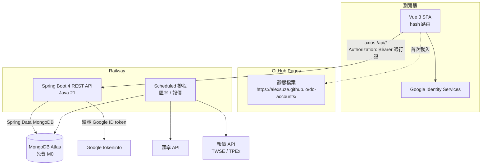
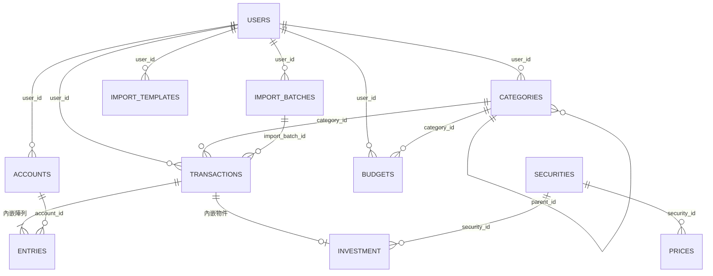
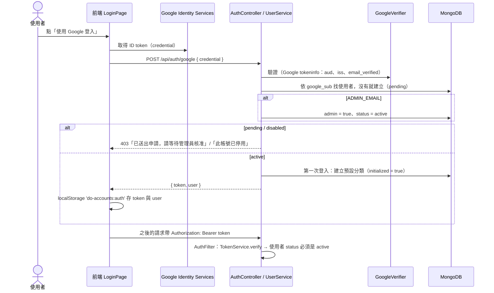
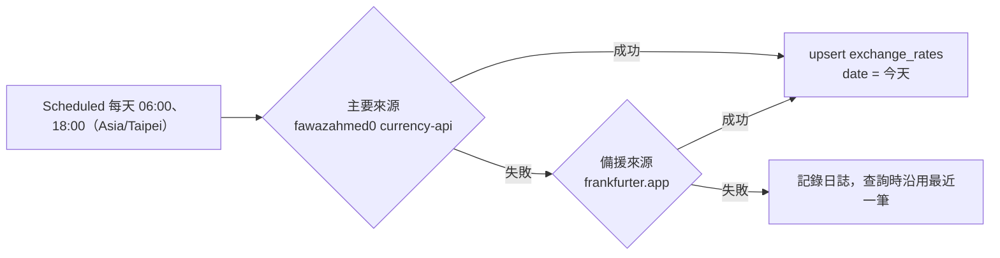
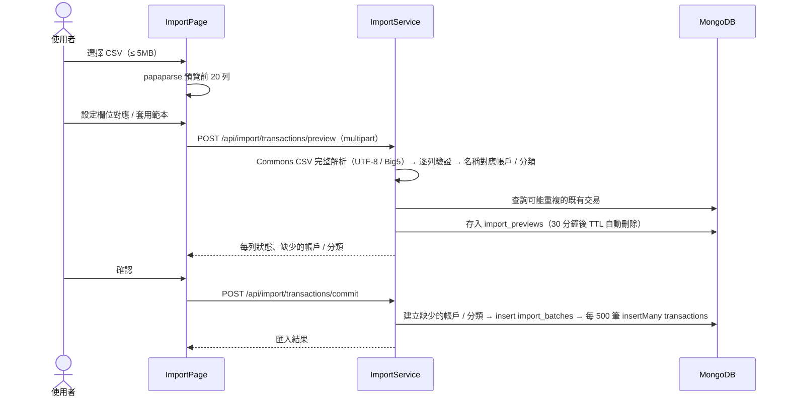
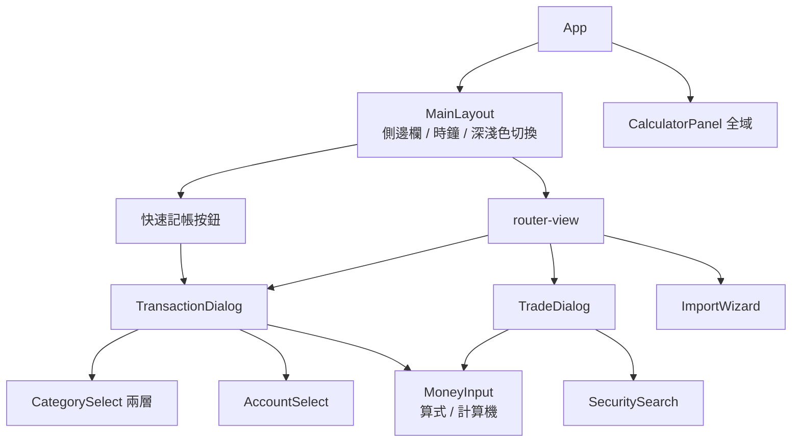

# 系統設計文件（SD — System Design）

# do-accounts 個人記帳理財系統（新版）

| 項目 | 內容 |
|---|---|
| 文件版本 | 0.2（草案，待確認） |
| 系統版本 | 2.0.0（規劃中） |
| 撰寫日期 | 2026-11-09 |
| 文件性質 | 系統設計（SD） |
| 相關文件 | [SA.md（系統分析文件）](./SA.md) |
| 架構參考 | [alexsuze/to-do-schedule](https://github.com/alexsuze/to-do-schedule)（技術棧、目錄結構、登入、部署方式與其一致） |

> v0.2 變更：後端改為 Java（Spring Boot），整體技術架構比照 to-do-schedule。
> 資料庫因此改回 MongoDB Atlas，登入改為 Google 登入＋管理員核准。
> **UI 元件庫（Quasar 或其他）暫不決定**，等 UI 設計確認後再選，見 1.5。
> 帳務核心設計（交易＋分錄、精確金額、每日匯率）維持不變，改以 MongoDB 的方式實作，見第 2 章。

---

## 1. 系統架構設計

### 1.1 整體架構

與 to-do-schedule 相同：前端是靜態網站，放在 GitHub Pages；後端是 Spring Boot API，放在 Railway；資料庫用 MongoDB Atlas 免費層。



### 1.2 技術棧

| 層 | 技術 | 與 to-do-schedule | 說明 |
|---|---|---|---|
| 前端建置 | Vite | 相同 | |
| 前端框架 | Vue 3（`<script setup>`，JavaScript） | 相同 | |
| UI 元件 | **待定**（見 1.5） | 待定 | to-do-schedule 使用 Quasar；本專案等 UI 設計確認後再決定 |
| 狀態管理 | Pinia | 相同 | 每個資源一個 store，負責呼叫 API 與快取清單 |
| 路由 | Vue Router，`createWebHashHistory` | 相同 | GitHub Pages 子路徑重新整理不會 404 |
| HTTP | axios（`services/api.js` 統一 instance） | 相同 | 自動帶通行證、401 自動回登入頁、統一顯示錯誤 |
| 拖曳 | vuedraggable | 相同 | 帳戶、分類排序 |
| 圖表 | Chart.js ＋ vue-chartjs | **新增** | 舊版 money 已在用 |
| 金額計算（前端） | decimal.js-light | **新增** | 表單即時計算、加總顯示 |
| CSV 解析（前端預覽） | papaparse | **新增** | 匯入時預覽前 20 列 |
| 後端語言 | Java 21 | 相同 | |
| 後端框架 | Spring Boot 4.1.x（webmvc、data-mongodb、validation、actuator） | 相同 | |
| 建置工具 | Maven Wrapper（`./mvnw`） | 相同 | 本機不需另裝 Maven |
| CSV（後端） | Apache Commons CSV | **新增** | 匯出、匯入完整解析；Big5 用 Java 內建 Charset |
| 外部 HTTP | Spring `RestClient` | 相同 | Google、匯率、報價 |
| 排程 | `@EnableScheduling` ＋ `@Scheduled(zone = "Asia/Taipei")` | 相同 | |
| 資料庫 | MongoDB Atlas 免費層 | 相同 | |
| 登入 | Google 登入 ＋ 管理員核准 ＋ HMAC 通行證 | 相同 | 直接沿用 `AuthFilter`、`TokenService`、`GoogleVerifier`、`UserService` 的設計 |
| Email | Resend（選用） | 相同 | 新帳號申請通知管理員；之後可加每月報表 |
| 測試（後端） | JUnit 5 ＋ Mockito（service 單元測試，不需要 MongoDB） | 相同 | |
| 測試（前端） | Node 內建 `node --test`（`src/utils` 純函式） | 相同 | |
| 部署 | 前端 GitHub Actions → Pages；後端 Railway（Nixpacks，JDK 21） | 相同 | |

### 1.3 目錄結構（monorepo）

```
do-accounts/
├── docs/                         # SA、SD、開發進度
├── frontend/
│   ├── src/
│   │   ├── main.js               # Pinia、Router、UI 元件庫初始化
│   │   ├── App.vue
│   │   ├── router/index.js       # hash 路由、登入守衛、管理頁守衛
│   │   ├── layouts/MainLayout.vue # 側邊欄（桌面）/ 收合選單（手機）、時鐘、主題切換
│   │   ├── pages/                # 每個頁面一個檔案（見 5.1）
│   │   ├── components/           # TransactionDialog、TradeDialog、MoneyInput、CalculatorPanel…
│   │   ├── stores/               # auth、accounts、categories、transactions、budgets、reports、investments、fx
│   │   ├── services/             # api.js、session.js
│   │   ├── utils/                # money.js、date.js、expr.js（算式計算）＋ *.test.js
│   │   └── css/                  # app.css（全站樣式、深淺色 CSS 變數）
│   ├── vite.config.js            # base 由 VITE_BASE_PATH 決定
│   ├── .env.example
│   └── package.json
├── backend/
│   ├── src/main/java/com/doaccounts/
│   │   ├── BackendApplication.java   # @EnableScheduling、@ConfigurationPropertiesScan
│   │   ├── config/               # AuthFilter、WebConfig（CORS）、MongoConfig、AppProperties、JacksonConfig、IndexInitializer
│   │   ├── controller/           # 每個資源一個 Controller，只做輸入輸出
│   │   ├── model/                # @Document 類別
│   │   ├── repository/           # MongoRepository 介面
│   │   └── service/              # 商業邏輯；複雜查詢用 MongoTemplate
│   ├── src/main/resources/application.properties
│   ├── src/test/java/com/doaccounts/service/   # 各 service 單元測試
│   ├── pom.xml
│   ├── railway.toml
│   ├── nixpacks.toml
│   └── .env.example
├── .github/workflows/deploy-frontend.yml
├── CLAUDE.md
└── README.md
```

### 1.4 共通慣例（比照 to-do-schedule）

- 所有 API 路徑以 `/api/` 開頭，回傳 JSON；**欄位一律 snake_case**（`spring.jackson.property-naming-strategy=SNAKE_CASE`），與 Mongo 欄位名稱相同。
- 前端一律透過 `services/api.js` 呼叫後端。
- Controller 用 `@RequestAttribute(AuthFilter.USER) User user` 取得目前使用者，並把 `user.id` 傳給 service；service 所有公開方法的第一個參數都是 `userId`。
- 別人的資料一律回 404「找不到」，不透露資料是否存在。
- 業務錯誤丟 `ResponseStatusException`，並帶中文訊息；回應格式為 RFC 9457 Problem Details（`spring.mvc.problemdetails.enabled=true`），訊息放在 `detail`。前端在 axios interceptor 統一用通知元件（toast）顯示。
- request／response 用 Java `record` 定義在對應的 service 內（例如 `TransactionService.TransactionRequest`）。
- 時間戳記以 UTC `Instant` 保存；**交易日期**以 `"YYYY-MM-DD"` 字串保存（理由見 2.1）。
- 不使用軟刪除：記帳資料刪除就是真的刪除（匯入可整批撤銷，資料可匯出備份）。

### 1.5 待定：UI 元件庫

UI 元件庫等 UI 設計（頁面示意圖）確認後再決定，不影響後端與資料庫設計。前端的 `router`、`stores`、`services/api.js`、`utils` 都不依賴元件庫，可以先開發。

| 選項 | 適合的情況 | 注意事項 |
|---|---|---|
| Quasar 2 | 想和 to-do-schedule 一致；需要完整的表格、日期選擇器、通知、深色模式 | 外觀偏 Material Design，大幅客製化較費工 |
| Tailwind CSS（＋ Headless UI／Reka UI） | UI 設計有明確的自訂風格 | 表格、日期選擇器要自己組或另找套件 |
| Element Plus／Naive UI | 偏後台管理風格、表格與表單多 | 手機版體驗較弱 |
| Bootstrap 5 | 熟悉度高、快速完成 | 外觀較制式 |

決定後要更新的地方：1.2 技術棧、1.3 `main.js` 與 `css/`、5.3 元件、5.4 響應式與主題。

---

## 2. 資料庫設計（MongoDB）

### 2.1 設計原則

1. **一次記帳只寫一份文件。** MongoDB 的單一文件寫入天生就是原子操作，所以把「交易」和它的「分錄」放在同一份文件裡（`entries` 陣列）。轉帳兩邊的金額必然同時成功或同時失敗，不需要多文件交易（multi-document transaction）。投資買賣也放在同一份交易文件裡，現金與持股同步。
2. **餘額由分錄推導。** 帳戶不存 `balance`；餘額 = `opening_balance` ＋ 所有交易中屬於該帳戶的分錄加總（aggregation）。不需要舊版的 apply／revert，也不需要「同步資料」。
3. **金額用 `Decimal128`。** Java 端用 `BigDecimal`，並在欄位加上 `@Field(targetType = FieldType.DECIMAL128)`（Spring Data 預設會把 `BigDecimal` 存成字串，無法加總，所以一定要指定）。API JSON 中，金額以**字串**輸出（`JacksonConfig` 把 `BigDecimal` 序列化成字串），避免 JavaScript 浮點誤差。
4. **交易日期存 `"YYYY-MM-DD"` 字串。** 記帳日期本身沒有時區，存成 `Date` 反而容易在 UTC 換算時跑到前一天。字串依字典順序就是日期順序，可以用 `$gte`／`$lte` 做範圍查詢並建索引（舊版的問題在於用正規表達式查月份，新版不再這樣做）。
5. **欄位 snake_case、主鍵 ObjectId**（Java 端為 `String id`），與 to-do-schedule 相同。
6. **索引在背景建立。** to-do-schedule 沒有建索引，因為開啟 `auto-index-creation` 後，本機沒有 MongoDB 時會無法啟動。記帳資料需要依日期與帳戶查詢，所以改用 `IndexInitializer`：伺服器啟動完成（`ApplicationReadyEvent`）後，在背景用 `MongoTemplate.indexOps().ensureIndex()` 建立索引；失敗只記錄日誌，不影響啟動。

### 2.2 users（比照 to-do-schedule，加上記帳偏好）

| 欄位 | 型別 | 說明 |
|---|---|---|
| _id | ObjectId | |
| google_sub | string | Google 帳號唯一 id |
| email / name / picture | string | 每次登入時更新 |
| status | string | `pending` 待核准 / `active` 使用中 / `disabled` 已停用 |
| admin | boolean | `ADMIN_EMAIL` 的帳號登入時自動設為 true 並啟用 |
| base_currency | string | 本位幣，預設 `TWD` |
| settings | object | `{ week_start, budget_warn_pct, income_color_scheme, … }` |
| initialized | boolean | 是否已建立預設分類（第一次被核准登入時建立） |
| created_at / last_login_at | Date | |

### 2.3 accounts

| 欄位 | 型別 | 說明 |
|---|---|---|
| _id | ObjectId | |
| user_id | string | |
| name | string | 1～30 字，同使用者內不重複 |
| kind | string | `cash` / `bank` / `credit_card` / `e_wallet` / `investment` / `loan` / `other` |
| currency | string | ISO 4217（`TWD` / `USD` / `JPY`…）；有交易後不可變更 |
| opening_balance | Decimal128 | 初始餘額；信用卡／貸款為負數。有交易後仍可修改（餘額即時計算，自動生效） |
| opening_date | string | `YYYY-MM-DD`，開戶日期；資產趨勢從這天開始計入。所有交易日期必須 ≥ 此日期；修改時不可晚於該帳戶最早的交易日期（否則 422） |
| order | int | 同 kind 內的顯示順序 |
| visible | boolean | 首頁是否顯示 |
| archived_at | Date / null | 非 null 即封存 |
| credit | object / null | 信用卡：`{ limit, statement_day, due_day }` |
| note | string | |
| created_at / updated_at | Date | |

索引：`{ user_id: 1, kind: 1, order: 1 }`。

### 2.4 categories

| 欄位 | 型別 | 說明 |
|---|---|---|
| _id | ObjectId | |
| user_id | string | |
| kind | string | `income` / `expense` |
| parent_id | string / null | 上層分類；只允許兩層（service 檢查上層的 `parent_id` 必須是 null） |
| name | string | 1～30 字，同上層內不重複 |
| icon | string | Material Icons 名稱 |
| color | string | `#RRGGBB`（存大寫） |
| order | int | |
| system_key | string / null | `other` / `adjustment` / `fee` / `investment_pnl`；非 null 不可刪除 |

### 2.5 transactions（核心）

一份文件就是使用者看到的一筆交易，分錄內嵌在 `entries` 陣列。

| 欄位 | 型別 | 說明 |
|---|---|---|
| _id | ObjectId | |
| user_id | string | |
| kind | string | `income` / `expense` / `transfer` / `investment` |
| date | string | `YYYY-MM-DD` |
| title | string | 項目名稱，1～100 字 |
| category_id | string / null | 收支必填；轉帳、投資為 null |
| note | string | |
| tags | string[] | |
| entries | array | 分錄，見下表 |
| investment | object / null | `kind = investment` 時的投資明細，見 2.6 |
| import_batch_id | string / null | 由哪一次匯入建立 |
| created_at / updated_at | Date | |

**entries 陣列元素**

| 欄位 | 型別 | 說明 |
|---|---|---|
| account_id | string | |
| amount | Decimal128 | 帳戶幣別；流入為正、流出為負 |
| role | string | `main` / `transfer_out` / `transfer_in` / `fee` / `settlement` |
| category_id | string / null | 只有 `fee` 使用（手續費的支出分類） |

**各類型的分錄規則**（`TransactionService` 驗證）

| kind | 分錄 | 範例 |
|---|---|---|
| expense | 1 筆 `main`，amount < 0 | 午餐 120：現金 −120 |
| income | 1 筆 `main`，amount > 0 | 薪水：銀行 +50,000 |
| transfer | `transfer_out` < 0 ＋ `transfer_in` > 0（不同帳戶）；選填 1 筆 `fee` < 0（記在轉出帳戶） | 換匯：TWD 銀行 −32,000、USD 帳戶 +1,000、手續費 −30 |
| investment | 1 筆 `settlement`（買進 < 0、賣出／股利 > 0），記在交割帳戶；股數記在 `investment` | 買 0050：交割帳戶 −10,020 |

**收支統計規則**：只計 `main` 與 `fee` 分錄；`transfer_in`／`transfer_out`／`settlement` 只是資產形式轉換，不計入收支。投資的股利與獨立費用，會另外計入系統分類「投資損益」（見 2.6）。

索引：`{ user_id: 1, date: -1 }`、`{ "entries.account_id": 1, date: 1 }`、`{ user_id: 1, category_id: 1, date: -1 }`、`{ import_batch_id: 1 }`（sparse）、`{ user_id: 1, "investment.security_id": 1, date: 1 }`（sparse）。

**帳戶餘額查詢**（`AccountService.balances(userId)`，MongoTemplate aggregation）：

```js
db.transactions.aggregate([
  { $match: { user_id: userId } },
  { $unwind: "$entries" },
  { $group: { _id: "$entries.account_id", sum: { $sum: "$entries.amount" } } }
])
// 應用層：balance = account.opening_balance + (sum ?? 0)
```

個人規模（數萬筆）只要數十毫秒。之後若變慢，可以在 `accounts` 加 `balance_cache` 欄位，在每次寫入交易後用 `$inc` 更新（見 ADR-04）。

### 2.6 investment（交易文件內嵌）與 securities、prices

**transactions.investment**

| 欄位 | 型別 | 說明 |
|---|---|---|
| account_id | string | 持有證券的投資帳戶（kind = `investment`） |
| security_id | string | |
| trade_type | string | `buy` / `sell` / `cash_dividend` / `stock_dividend` / `split` / `fee` |
| quantity | Decimal128 | 股數（買、賣、股票股利）；`split` 存分割比例 |
| price | Decimal128 | 證券幣別的成交價 |
| fee / tax | Decimal128 | |

交割帳戶（`entries[0].account_id`）可以是投資帳戶本身（券商交割戶），也可以是另一個銀行帳戶。

`stock_dividend`、`split` 沒有現金流動，`entries` 為空陣列。`cash_dividend` 的 `settlement` 分錄在統計中當成「投資損益」收入；`fee` 當成「投資損益」支出。

**securities**（全站共用，不分使用者）

| 欄位 | 型別 | 說明 |
|---|---|---|
| _id | ObjectId | |
| market | string | `TW`（上市）/ `TWO`（上櫃）/ `US` / `FUND` / `CRYPTO` / `OTHER` |
| symbol | string | 唯一索引 `{ market, symbol }` |
| name | string | |
| currency | string | |
| asset_type | string | `stock` / `etf` / `fund` / `bond` / `crypto` / `other` |

**prices**

| 欄位 | 型別 | 說明 |
|---|---|---|
| _id | ObjectId | |
| security_id | string | 唯一索引 `{ security_id, date }` |
| date | string | `YYYY-MM-DD` |
| close | Decimal128 | |
| source | string | `twse` / `tpex` / `manual` |
| user_id | string / null | 手動輸入時記錄是誰輸入的 |

### 2.7 budgets

| 欄位 | 型別 | 說明 |
|---|---|---|
| _id | ObjectId | |
| user_id | string | |
| month | string | `YYYY-MM` |
| category_id | string / null | null = 當月總預算；只能是支出分類 |
| amount | Decimal128 | 本位幣 |
| recurring | boolean | 循環：之後沒有設定的月份沿用這一筆 |

唯一索引：`{ user_id, month, category_id }`。

### 2.8 exchange_rates

| 欄位 | 型別 | 說明 |
|---|---|---|
| _id | ObjectId | |
| date | string | `YYYY-MM-DD` |
| currency | string | 例如 `USD` |
| base | string | 例如 `TWD` |
| rate | Decimal128 | 1 currency = rate base |
| source | string | `fawazahmed0` / `frankfurter` / `seed` / `manual` |
| user_id | string / null | 手動覆寫時為該使用者；系統抓取的為 null（全站共用） |

唯一索引：`{ date, currency, base, user_id }`。

### 2.9 匯入相關

**import_batches**：`_id, user_id, file_name, row_count, imported_count, skipped_count, status (completed / failed / reverted), created_at, reverted_at`

**import_templates**：`_id, user_id, name, mapping`（object：欄位對應、日期格式、金額正負規則、預設帳戶、編碼）

**import_previews**：`_id, user_id, rows (array), expire_at`；TTL 索引 `{ expire_at: 1 }, expireAfterSeconds: 0`，30 分鐘後由 MongoDB 自動刪除。

### 2.10 容量估算

一份交易文件約 400～600 bytes。每天記 20 筆、記 10 年約 7 萬筆，大約 40MB，遠低於 Atlas M0 的 512MB 上限。

### 2.11 集合關聯圖



---

## 3. API 設計

### 3.1 共通規範

- Base URL：`{VITE_API_BASE_URL}/api`（本機 `http://localhost:8080/api`；正式為 Railway 網址）
- 驗證：Header `Authorization: Bearer <通行證>`。不需登入的只有 `POST /api/auth/google`、`GET /api/ping`、actuator health。
- CORS：只允許 `CORS_ALLOWED_ORIGIN`（`https://alexsuze.github.io`、`http://localhost:5173`），以最前面的 filter 實作，讓 401 也帶 CORS 標頭（比照 to-do-schedule `WebConfig`）。
- 金額、股數、匯率以字串傳遞；日期 `YYYY-MM-DD`；月份 `YYYY-MM`；JSON 欄位 snake_case。
- 列表分頁：`?page=0&size=50`，回傳 `{ items, page, size, total }`（個人資料量用 offset 分頁即可）。
- 錯誤：Problem Details，例如：

```json
{ "type": "about:blank", "title": "Unprocessable Entity", "status": 422, "detail": "賣出股數超過持有股數（持有 1,000 股）" }
```

| HTTP | 情境 |
|---|---|
| 400 | 輸入格式錯誤（名稱長度、金額格式、日期格式） |
| 401 | 沒有通行證、通行證過期、帳號已停用（前端自動回登入頁） |
| 403 | 待核准／已停用帳號登入；非管理員使用管理功能 |
| 404 | 資料不存在或不屬於本人 |
| 409 | 名稱重複；帳戶有交易不能刪除；系統分類不能刪除 |
| 422 | 違反帳務規則（封存帳戶記帳、賣超、分類類型不符） |

### 3.2 登入與使用者 `/api/auth`、`/api/admin`（沿用 to-do-schedule）

| 方法 | 路徑 | 說明 |
|---|---|---|
| POST | `/api/auth/google` | body `{ credential }`（Google ID token）→ `{ token, user }`；新帳號為 pending 並回 403「已送出申請，請等待管理員核准」 |
| GET | `/api/auth/me` | 目前使用者 |
| PUT | `/api/auth/me/settings` | 本位幣、偏好設定 |
| GET | `/api/admin/users` | 使用者清單（限管理員） |
| PUT | `/api/admin/users/{id}/status` | `{ status }` 核准／停用 |
| POST | `/api/admin/jobs/{name}` | 手動執行排程（`fx`、`quotes`） |
| GET | `/api/ping` | 不需登入；前端用來喚醒 Railway 服務 |

### 3.3 帳戶 `/api/accounts`

| 方法 | 路徑 | 說明 |
|---|---|---|
| GET | `/api/accounts` | 含計算出的 `balance` 與 `balance_in_base`；`?include_archived=true` |
| POST | `/api/accounts` | 新增 |
| PUT | `/api/accounts/reorder` | `{ kind, ids }` 同一 kind 的新順序（路由放在 `/{id}` 之前） |
| PUT | `/api/accounts/{id}` | 完整覆寫編輯；有交易時改幣別 → 409；`opening_balance` 可隨時改；`opening_date` 晚於最早交易日期 → 422 |
| DELETE | `/api/accounts/{id}` | 有交易 → 409「請改用封存」 |
| POST | `/api/accounts/{id}/archive`、`/unarchive` | 封存／取消封存 |
| GET | `/api/accounts/{id}/history?from&to` | 每日餘額（帳戶頁走勢圖） |

### 3.4 交易 `/api/transactions`

| 方法 | 路徑 | 說明 |
|---|---|---|
| GET | `/api/transactions` | 篩選 `from, to, account_id, category_id, kind, tag, q, min, max`（可複選者用逗號分隔）、分頁；另回傳 `daily_totals` |
| POST | `/api/transactions` | 新增收入／支出／轉帳 |
| PUT | `/api/transactions/{id}` | 完整覆寫（`kind = investment` 的請改走投資 API → 422） |
| DELETE | `/api/transactions/{id}` | |
| POST | `/api/transactions/bulk-delete` | `{ ids }` |
| POST | `/api/transactions/bulk-update` | `{ ids, category_id?, add_tags?, remove_tags? }` |
| GET | `/api/transactions/suggest?q=` | 依項目名稱回傳最常用的分類與帳戶 |
| GET | `/api/transactions/export` | CSV 下載，參數同列表篩選 |

新增交易的 request（`TransactionService.TransactionRequest`；JSON 為 snake_case：`category_id`、`to_account_id`…）：

```java
public record TransactionRequest(
        String kind,            // income / expense / transfer
        String date,            // YYYY-MM-DD
        String title,
        String note,
        List<String> tags,
        String categoryId,      // 收支必填
        String accountId,       // 收支：帳戶；轉帳：轉出帳戶
        BigDecimal amount,      // 一律正數；收支金額或轉出金額
        String toAccountId,     // 轉帳：轉入帳戶
        BigDecimal toAmount,    // 跨幣別轉帳必填；同幣別省略
        BigDecimal fee,         // 轉帳手續費（選填，正數）
        String feeCategoryId) {}
```

### 3.5 分類 `/api/categories`

| 方法 | 路徑 | 說明 |
|---|---|---|
| GET | `/api/categories` | 全部分類（前端組成樹狀） |
| POST | `/api/categories` | |
| PUT | `/api/categories/reorder` | `{ ids }` 同一層的新順序 |
| PUT | `/api/categories/{id}` | 不能改 `kind`；`parent_id` 只能指向同 kind 的頂層分類 |
| DELETE | `/api/categories/{id}?move_to=` | 有交易或子分類時必須帶 `move_to`；系統分類 → 409 |

### 3.6 預算 `/api/budgets`

| 方法 | 路徑 | 說明 |
|---|---|---|
| GET | `/api/budgets?month=YYYY-MM` | 當月有效預算（含循環沿用），每筆含 `spent`、`remaining`、`percentage`、`projected` |
| PUT | `/api/budgets` | Upsert `{ month, category_id, amount, recurring }` |
| DELETE | `/api/budgets/{id}` | |
| POST | `/api/budgets/copy` | `{ from_month, to_month }` |

### 3.7 報表 `/api/reports`

| 方法 | 路徑 | 回傳 |
|---|---|---|
| GET | `/api/reports/dashboard` | 淨資產三數字、本月收支、預算概況、最近 5 筆交易 |
| GET | `/api/reports/net-worth?from=YYYY-MM&to=YYYY-MM` | `[{ month, assets, liabilities, investments, net_worth }]` |
| GET | `/api/reports/breakdown?from&to&kind` | 分類（含子類）金額與百分比 |
| GET | `/api/reports/daily?month=` | `[{ date, income, expense }]` 與當月合計 |
| GET | `/api/reports/category-trend?category_id&months=12` | `[{ month, amount }]` |

### 3.8 匯率 `/api/fx`

| 方法 | 路徑 | 說明 |
|---|---|---|
| GET | `/api/fx/latest` | 各支援幣別對本位幣的最新匯率與日期 |
| GET | `/api/fx/history?currency&from&to` | |
| PUT | `/api/fx/manual` | `{ date, currency, rate }` 手動覆寫（只影響自己） |

### 3.9 投資 `/api/investments`

| 方法 | 路徑 | 說明 |
|---|---|---|
| GET | `/api/investments/securities?q=&market=` | 先查 `securities`；台股查不到時查 TWSE／TPEx 清單 |
| POST | `/api/investments/securities` | 手動建立 |
| GET | `/api/investments/holdings?account_id=` | 持倉：股數、均價、成本、現價（含報價日期）、市值、未實現損益、報酬率 |
| GET | `/api/investments/summary` | 總市值、總損益、累積股利、配置比例 |
| GET | `/api/investments/trades?account_id&security_id&from&to` | 投資交易列表（分頁） |
| POST | `/api/investments/trades` | 新增（寫入一份 `kind = investment` 的 transactions 文件） |
| PUT | `/api/investments/trades/{id}` | |
| DELETE | `/api/investments/trades/{id}` | |
| GET | `/api/investments/realized?year=` | 已實現損益明細 |
| PUT | `/api/investments/prices` | `{ security_id, date, close }` 手動報價 |
| GET | `/api/investments/trades/export` | CSV |

### 3.10 匯入匯出 `/api/import`、`/api/export`

| 方法 | 路徑 | 說明 |
|---|---|---|
| POST | `/api/import/transactions/preview` | multipart：`file` ＋ `mapping`（JSON）→ `{ preview_id, rows[{ line, status: ok/duplicate/error, message, parsed }], missing_accounts, missing_categories }` |
| POST | `/api/import/transactions/commit` | `{ preview_id, skip_lines, create_missing }` → ImportBatch |
| GET | `/api/import/batches` | 匯入紀錄 |
| POST | `/api/import/batches/{id}/revert` | 整批撤銷 |
| GET / POST / PUT / DELETE | `/api/import/templates[/{id}]` | 匯入範本 |
| POST | `/api/import/trades/preview`、`/commit` | 投資交易匯入 |
| GET | `/api/export/backup` | 完整 JSON 備份下載 |
| POST | `/api/import/backup` | 從 JSON 還原（只限還沒有任何交易的帳號） |

---

## 4. 核心模組設計

### 4.1 登入（沿用 to-do-schedule）



- **通行證**：`base64url("userId:到期秒數") + "." + base64url(HMAC-SHA256)`，有效 30 天（`TokenService`，不使用 JWT 函式庫）。
- `JWT_SECRET` 至少 32 字元；正式環境沒有設定就拒絕啟動。
- 每個請求都會重新查使用者狀態，所以管理員停用帳號後立即生效。
- localStorage key 必須帶專案名稱（`do-accounts:auth`），因為 `alexsuze.github.io` 底下所有專案共用同一塊 localStorage。
- 新帳號申請時，用 Resend 寄信通知管理員（寄不出去只記錄，不影響申請）。

### 4.2 交易服務（`TransactionService`）

```
create(userId, req):
  1. validate：
     - date 為合法 YYYY-MM-DD；title 1～100 字；amount > 0，小數位數不超過帳戶幣別的位數
     - 帳戶屬於 userId 且未封存（否則 404 / 422）
     - date ≥ 每個相關帳戶的 opening_date（收支帳戶、轉出與轉入帳戶；投資另含投資帳戶與交割帳戶），否則 422「交易日期不能早於帳戶開戶日期（YYYY-MM-DD）」
     - 收支：category 屬於 userId，且 category.kind == req.kind
     - 轉帳：account ≠ toAccount；幣別相同時 toAmount 必須為 null 或等於 amount；幣別不同時 toAmount 必填
  2. buildEntries(req)：依 2.5 規則表產生分錄
  3. repo.save(transaction)   ← 單一文件寫入，原子操作

update(userId, id, req):
  找到自己的交易（kind = investment → 422）→ validate → 重建 entries → save（整份覆寫）

delete(userId, id):
  找到自己的交易 → deleteById
```

`buildEntries` 是純函式（只依賴 request 與帳戶資料），單元測試涵蓋每種交易類型、跨幣別、手續費和各種錯誤情況。

### 4.3 金額處理

- 幣別設定（後端 `Currencies`、前端 `utils/money.js`，內容一致）：

  | 幣別 | 小數位數 | 符號 |
  |---|---|---|
  | TWD | 0 | NT$ |
  | JPY | 0 | ¥ |
  | USD | 2 | $ |

  要新增幣別，兩邊各加一行即可。

- 後端：一律用 `BigDecimal`；換算結果用 `setScale(4, RoundingMode.HALF_UP)` 保存，顯示時依幣別位數四捨五入。
- MongoDB：`@Field(targetType = FieldType.DECIMAL128)`；aggregation 的 `$sum` 對 Decimal128 是精確計算。
- JSON：`JacksonConfig` 註冊 `BigDecimal` → `ToStringSerializer`，前端收到字串。
- 前端：`MoneyInput` 元件可輸入算式（`120+35*2`），由 `utils/expr.js` 解析（只接受數字、`+ - * / ( ) .`，不使用 `eval`），再用 decimal.js-light 計算。

### 4.4 匯率服務（`FxService`）



```java
public interface FxService {
    BigDecimal rate(String userId, String currency, String onDate);            // 1 currency = ? 本位幣
    BigDecimal toBase(String userId, BigDecimal amount, String currency, String onDate);
    RateTable table(String userId, Set<String> currencies, String from, String to); // 報表一次載入整段期間
}
```

- 取「`date <= onDate` 中最新的一筆」，使用者的手動值優先。
- 報表一次載入整段期間的匯率（`RateTable`），在記憶體中查找，避免逐筆查詢資料庫。
- 啟動時如果某個幣別完全沒有匯率，就寫入內建的初始匯率（`source = seed`），確保第一次部署就能換算。
- 本位幣與交易幣別相同時直接回傳 1。

### 4.5 投資計算（`HoldingCalculator`，純函式）

採移動平均成本法：

```
for trade in 該帳戶該證券的投資交易（依 date、created_at 排序）:
  buy:            cost += qty × price + fee + tax
                  held += qty
  sell:           若 qty > held → 錯誤（寫入時就擋下）
                  avg = cost / held
                  realized += qty × price − fee − tax − qty × avg
                  cost −= qty × avg；held −= qty
  cash_dividend:  dividends += 交割金額
  stock_dividend: held += qty（成本不變）
  split:          held ×= ratio
  fee:            cost += fee
市值 = held × 最新收盤價
未實現損益 = 市值 − cost
報酬率 = (未實現 + 已實現 + 股利) / 累計買進成本
```

- 新增、修改、刪除投資交易時，重新計算該證券的整段歷史；若任何時間點持股變成負數就回 422（修改過去的交易也會檢查）。
- 交割金額由前端依台股規則帶入預設值（手續費 `max(20, 成交金額 × 0.1425% × 折扣)`、賣出證交稅股票 0.3%／ETF 0.1%），使用者可以修改。
- 首頁淨資產與資產趨勢中，投資市值 = 持股 × 當日（或之前最近一天）收盤價 × 當日匯率。

**報價來源**（`QuoteProvider` 介面，可以替換）

| 市場 | 第一版 | 排程 |
|---|---|---|
| TW 上市 | TWSE OpenAPI 每日收盤（免金鑰） | 週一到週五 14:30（Asia/Taipei），只抓有持倉的證券 |
| TWO 上櫃 | TPEx OpenAPI（免金鑰） | 同上 |
| US／基金／其他 | 手動輸入 | — |

### 4.6 報表演算法（`ReportService`，MongoTemplate aggregation）

**淨資產趨勢**

1. 用一次 aggregation 取得每個帳戶每個月的分錄加總：`$match user_id` → `$unwind entries` → `$group { account_id, month: $substr(date, 0, 7) }`。
2. 在應用層依月份累加，得出每個帳戶每個月底的餘額（從 `opening_date` 起算）。
3. 用 `RateTable` 依各月底的匯率換算成本位幣。
4. 加上各月底的投資市值（`HoldingCalculator` ＋ 月底報價）。
5. 正餘額算資產、負餘額算負債；信用卡與貸款帳戶固定算負債。當月以今天為準。

**收支結構／每日收支**：`$match { user_id, date 範圍 }` → `$unwind entries` → `$match role in [main, fee]` → 依交易日匯率換算 → 依分類（`fee` 用 `entries.category_id`）或日期分組。

### 4.7 CSV 匯入（`ImportService`）



- 重複判斷：同 `date` ＋ 同帳戶 ＋ 同金額，且 `title` 去除空白後相同或互相包含。
- 金額正負規則：「單一金額欄，負數是支出」或「收入欄、支出欄分開」。
- **寫入失敗的補償**：MongoDB 這裡不使用多文件交易，所以中途失敗時，直接刪除該 `import_batch_id` 已寫入的交易，並把批次標記為 `failed`。批次撤銷也是同一個動作：`deleteMany({ user_id, import_batch_id })`。
- **匯出**：欄位 `日期, 類型, 項目, 大類, 子類, 帳戶, 金額, 幣別, 轉入帳戶, 轉入金額, 標籤, 備註`；UTF-8 with BOM；用 `StreamingResponseBody` 邊查邊寫；開頭為 `= + - @` 的儲存格加 `'` 前綴，防止 CSV injection。這個格式可以直接再匯入（內建範本「do-accounts 格式」）。

### 4.8 前端計算機（沿用舊版 money）

全域浮動、可拖曳（pointer events，同時支援滑鼠和觸控）、鍵盤輸入（數字、`+ - * / .`、Enter、Backspace、`c`、Esc）、「帶入」按鈕把結果填回目前的金額欄位。改用 decimal 計算。

---

## 5. 前端設計

### 5.1 路由（hash 模式，比照 to-do-schedule `router/index.js`）

| 路徑 | 頁面 | 說明 |
|---|---|---|
| `#/login` | LoginPage | Google 登入；pending 時顯示「等待核准」 |
| `#/` | DashboardPage | 淨資產三卡、帳戶分組（拖曳排序）、本月收支與預算、最近交易、快速記帳 |
| `#/transactions` | TransactionsPage | 篩選列（同步到 URL query）、依日期分組、每日小計、分頁、批次操作 |
| `#/accounts`、`#/accounts/:id` | AccountsPage、AccountDetailPage | 帳戶管理；單一帳戶的餘額走勢與明細 |
| `#/categories` | CategoriesPage | 收入／支出頁籤，兩層分類，拖曳排序 |
| `#/budgets` | BudgetsPage | 月份切換、總預算與分類進度條、複製上月 |
| `#/reports` | ReportsPage | 淨資產、收支結構、每日、分類趨勢四個頁籤 |
| `#/investments`、`#/investments/:accountId` | InvestmentsPage、HoldingsPage | 總覽與配置圖、帳戶持倉、交易紀錄 |
| `#/import` | ImportPage | 步驟精靈（上傳 → 對應 → 預覽 → 完成）＋ 匯入紀錄 |
| `#/settings` | SettingsPage | 本位幣、偏好、外觀、匯率手動覆寫、匯出備份 |
| `#/admin` | AdminPage | 使用者核准／停用、手動執行排程（`meta.admin`） |

守衛：沒有通行證只能看登入頁，並記住原路徑（`redirect`，只接受站內路徑）；已登入時不顯示登入頁；管理頁只給管理員（後端也會擋）。

### 5.2 Pinia stores

| Store | 職責 |
|---|---|
| `auth` | 登入、登出、目前使用者、偏好設定 |
| `accounts` | 帳戶清單（含餘額）、依 kind 分組的 getter、CRUD、排序（樂觀更新，失敗回滾） |
| `categories` | 分類清單、樹狀 getter、`label(id)` |
| `transactions` | 目前篩選條件與分頁結果、CRUD；寫入成功後通知 `accounts` 重新載入 |
| `budgets` | 指定月份的預算與花費 |
| `reports` | 各報表資料（依參數快取） |
| `investments` | 持倉、投資交易、證券搜尋 |
| `fx` | 最新匯率、`toBase()` 顯示用換算 |

比照 to-do-schedule：store 的動作成功後用通知元件顯示「已新增…」，失敗由 `api.js` 統一顯示後端的 `detail`。

### 5.3 主要元件



### 5.4 響應式與主題

- 斷點：寬度 < 1024px 為手機／平板（卡片列表、全螢幕對話框、收合選單）；≥ 1024px 為桌面（表格、常駐側邊欄）。實際數值依 UI 設計與選定的元件庫調整。
- 深色／淺色：沒選過就跟隨系統，選擇存 localStorage（比照 to-do-schedule `utils/theme.js`）。
- 收入／支出顏色：預設收入綠、支出紅；設定可改為「紅收綠支」。

---

## 6. 部署與環境設計

### 6.1 環境

| 環境 | 前端 | 後端 | 資料庫 |
|---|---|---|---|
| 本機 | `npm run dev`（:5173） | `./mvnw spring-boot:run`（:8080） | Atlas 上另一個開發用資料庫 `do_accounts_dev`（或本機 MongoDB） |
| 正式 | GitHub Pages `https://alexsuze.github.io/do-accounts/` | Railway | Atlas `do_accounts` |

> 本機開發**不可**連正式資料庫（舊版 OBS-5）：`.env.example` 與 `application.properties` 的預設值都指向 `do_accounts_dev`。

### 6.2 部署流程（與 to-do-schedule 相同）

| 對象 | 流程 |
|---|---|
| 前端 | push `main` 且 `frontend/**` 有變動 → `.github/workflows/deploy-frontend.yml`：`npm ci` → `npm run build`（`VITE_BASE_PATH=/do-accounts/`）→ `deploy-pages` |
| 後端 | Railway 連結 repo，Root Directory = `backend`；`railway.toml`：build `./mvnw -q -DskipTests package`、start `java -jar target/backend-0.0.1-SNAPSHOT.jar`、healthcheck `/actuator/health/liveness`；`nixpacks.toml` 指定 `jdk21` |

### 6.3 環境變數

**後端（Railway Variables）**

| 變數 | 說明 |
|---|---|
| `MONGODB_URI` | Atlas 連線字串 |
| `MONGODB_DATABASE` | 正式環境設 `do_accounts` |
| `GOOGLE_CLIENT_ID` | Google OAuth 用戶端 ID |
| `ADMIN_EMAIL` | 管理員的 Google Email |
| `JWT_SECRET` | 通行證簽章密鑰，≥ 32 字元；可在 Railway 填 `${{ secret(64) }}` |
| `CORS_ALLOWED_ORIGIN` | `https://alexsuze.github.io` |
| `FRONTEND_URL` | `https://alexsuze.github.io/do-accounts/` |
| `RESEND_API_KEY` / `RESEND_FROM_EMAIL` | 選用，新帳號通知信 |

**前端（GitHub Secrets）**：`VITE_API_BASE_URL`、`VITE_GOOGLE_CLIENT_ID`

### 6.4 `application.properties` 重點

```properties
server.port=${PORT:8080}
spring.mongodb.uri=${MONGODB_URI:mongodb://localhost:27017/do_accounts_dev}
spring.mongodb.database=${MONGODB_DATABASE:do_accounts_dev}
management.endpoints.web.exposure.include=health
spring.jackson.property-naming-strategy=SNAKE_CASE
spring.mvc.problemdetails.enabled=true
spring.servlet.multipart.max-file-size=5MB
```

`MongoConfig` 沿用 to-do-schedule 的連線逾時設定（閒置 60 秒換新連線、連線／讀取 5～6 秒上限），避免 Railway ↔ Atlas 閒置斷線造成第一次操作逾時。

### 6.5 公開倉庫的安全規則（比照 to-do-schedule CLAUDE.md）

- 密碼、連線字串、`JWT_SECRET`、API 金鑰只放 Railway Variables、GitHub Secrets；`.env.example` 只放假值。
- `.env`、`.env.local`、`.claude/` 加入 `.gitignore`。
- 前端程式碼人人可見，權限一律由後端把關。

---

## 7. 安全性與品質設計

### 7.1 安全性

| 面向 | 設計 |
|---|---|
| 身分驗證 | Google 登入（tokeninfo 驗證 `aud`、`iss`、`email_verified`）＋ 管理員核准 |
| 通行證 | HMAC-SHA256，30 天；每個請求都檢查帳號 status；停用立即生效 |
| 授權 | service 方法強制帶 `userId`；查到別人的資料一律回 404；每個 service 都有「其他使用者不能存取」的單元測試 |
| CORS | 白名單 filter 放在最前面 |
| 輸入驗證 | service 內檢查長度、格式、金額位數；`@Valid` 用於簡單欄位 |
| 上傳 | 5MB 上限、只接受 CSV；不寫入檔案系統 |
| CSV 匯出 | 防止 CSV injection |
| 錯誤訊息 | 不回傳 stack trace；500 只回一般訊息 |

### 7.2 測試策略

| 層級 | 範圍 | 工具 |
|---|---|---|
| 後端單元 | `TransactionService.buildEntries`（每種類型、跨幣別、手續費、錯誤）、`HoldingCalculator`、`FxService` 查找、`ImportService` 解析與重複判斷、`BudgetService` 花費計算、`TokenService`、資料隔離 | JUnit 5 ＋ Mockito（比照 to-do-schedule：用 mock repository ＋ 記憶體 List，不需要 MongoDB） |
| 後端整合 | aggregation 查詢（餘額、報表） | `@DataMongoTest` ＋ Testcontainers MongoDB（CI 才跑；本機沒有 Docker 時略過） |
| 前端 | `utils/money.js`、`utils/expr.js`、`utils/date.js` | `node --test src/utils` |
| 手動驗收 | 每個階段結束後依 SA 使用案例實際操作 | — |

---

## 8. 開發階段規劃

| 階段 | 內容 | 完成標準 |
|---|---|---|
| 階段 0 基礎 | 頁面示意圖確認 → 決定 UI 元件庫（1.5）；monorepo 骨架、Spring Boot 專案、Vite ＋ Vue 前端、登入（直接移植 to-do-schedule 的 AuthFilter／TokenService／GoogleVerifier／UserService／AdminPage）、部署流程 | 可用 Google 登入，GitHub Pages ↔ Railway ↔ Atlas 接通 |
| 階段 1 核心記帳 | 帳戶、分類、交易（收支、轉帳）、首頁、計算機 | 可完成日常記帳，取代舊版 money |
| 階段 2 預算與報表 | 匯率排程、預算、四種報表 | 涵蓋舊版 money 全部功能 |
| 階段 3 匯入匯出 | CSV 匯出、匯入精靈、範本、撤銷、JSON 備份 | 能匯入一份實際的銀行對帳單 |
| 階段 4 投資 | 證券、投資交易、持倉、台股報價、整合淨資產 | 投資市值反映在首頁與趨勢圖 |
| 階段 5 打磨 | 快捷鍵、每月報表 Email（Resend）、PWA | — |

每個階段完成後更新 `docs/開發進度.md`（比照 to-do-schedule）。

---

## 9. 設計決策紀錄（ADR 摘要）

| # | 決策 | 理由 | 取捨 |
|---|---|---|---|
| ADR-01 | 技術架構比照 to-do-schedule（Java 21 ＋ Spring Boot 4 ＋ MongoDB Atlas ＋ Vue 3 ＋ Pinia ＋ GitHub Pages ＋ Railway） | 使用者指定；兩個專案共用同一套知識、登入程式與部署流程，維護成本最低；Atlas M0 免費 | v0.1 提案的 PostgreSQL 在報表 SQL 與多表交易上較方便，改用 MongoDB 後由 ADR-02 彌補 |
| ADR-02 | 分錄內嵌在交易文件中 | 單一文件寫入是原子操作，轉帳兩邊、投資現金與持股不會只寫一半，不需要 MongoDB 多文件交易（多文件交易要另外設定 `MongoTransactionManager`，本機獨立 MongoDB 也不支援） | 依帳戶查詢需要 `$unwind`；已建 `entries.account_id` 多鍵索引 |
| ADR-03 | 帳戶不存餘額，由分錄加總 | 單一資料來源，永遠一致，不需要「同步資料」 | 每次讀取都要 aggregation；個人資料量下只需數十毫秒 |
| ADR-04 | 先不做餘額快取 | 保持簡單 | 若之後變慢，可在寫入交易後用 `$inc` 更新 `accounts.balance_cache`，並保留全量重算作為校正 |
| ADR-05 | `BigDecimal` ＋ `Decimal128`，JSON 金額用字串 | 金額精確；Spring Data 預設會把 BigDecimal 存成字串，必須明確指定 | 前端要用 decimal.js-light 處理加總 |
| ADR-06 | 交易日期存 `YYYY-MM-DD` 字串 | 記帳日期沒有時區；`LocalDate` 轉 `Date` 會依伺服器時區換算，容易差一天；字串可做範圍查詢與索引 | 不能用 Mongo 的日期運算子，月份用 `$substr` 取前 7 碼 |
| ADR-07 | 沿用 Google 登入 ＋ 管理員核准 ＋ HMAC 通行證 | 不需處理密碼保存、忘記密碼、暴力破解；程式可直接從 to-do-schedule 移植 | 必須有 Google 帳號；通行證存 localStorage，無法單獨撤銷某台裝置（停用帳號可全部撤銷） |
| ADR-08 | 匯率按日保存 | 歷史報表使用當時匯率，數字不會因今天的匯率而改變 | 多一個排程與集合 |
| ADR-09 | 持倉即時計算，不存持倉集合 | 修改或刪除歷史交易後不會不同步 | 每次查詢都要重算；單一證券的交易筆數少，成本很低 |
| ADR-10 | 索引在啟動後背景建立 | 有索引才能做日期與帳戶查詢；背景建立又不會像 `auto-index-creation` 那樣讓本機沒有 MongoDB 時無法啟動 | 第一次部署的頭幾秒查詢可能沒有索引 |
| ADR-11 | 不遷移舊版 money 資料 | 使用者已確認從零開始 | 之後若需要，可寫腳本：舊 MongoDB → JSON 備份格式 → 用備份還原 |
| ADR-12 | UI 元件庫延後決定 | 使用者希望先確認 UI 設計；元件庫只影響前端畫面層 | 選定前，頁面元件不開始實作；前端邏輯層（stores、services、utils）可先做 |
